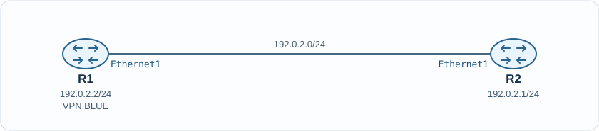

(section-operator-04-ip-routing-vpn-instance-1)=
# VPN 实例与路由隔离

<span id="overview"></span>

VPN 实例提供独立的路由表。在一台设备上可隔离不同租户的三层接口与路由，共用的设备可以承载重叠的地址规划。

<span id="principles"></span>

(section-operator-04-ip-routing-vpn-instance-2)=
## 工作原理

VPN 实例为业务分开三层接口和路由表。相同地址可在隔离的实例中分别使用。绑定接口、分配地址和检查下一跳应按正确的顺序在相同实例中完成。

VPN 实例为各租户提供独立路由表，可使用重叠地址规划。RD 和 RT 用于相应 VPN 路由交换。

<span id="examples"></span>

(section-operator-04-ip-routing-vpn-instance-3)=
## 配置与验证

(section-operator-04-ip-routing-vpn-instance-4)=
### 拓扑



(case-conditions-04-ip-routing-vpn-instance)=
### 配置条件

规划实例名称、地址族及关联接口。如果接口已有地址，绑定或切换 VPN 后须按目标实例重新配置所需的地址。

(section-operator-04-ip-routing-vpn-instance-5)=
### 配置步骤

```vortexros-config
ip vpn-instance BLUE
 ipv4-family
  route-distinguisher 65000:100
  vpn-target 65000:100 both
 ipv6-family
#
interface Ethernet 1
 ip binding vpn-instance BLUE
 ip address 192.0.2.2 255.255.255.0
#
return
```

录入并提交。仍有接口、路由或动态协议引用时，应先解除引用，再删除 VPN 实例。

(case-verification-04-ip-routing-vpn-instance)=
### 验证方法

对照以下命令和预期结果核对设备状态。

```vortexros-cli
display ip vpn-instance
display ip vpn-instance interface
display ip routing-table vpn-instance BLUE
```

确认 Ethernet1 属于 BLUE，并检查该路由表中的直连路径。从对应 VPN 发起连通性测试。

<span id="observed"></span>

(section-operator-04-ip-routing-vpn-instance-6)=
### 运行查询实测节选

r4 中创建了名为 ALL 的 VPN 实例，IPv4 地址族已启用。进一步验证需查询该实例自己的路由表。

```text
<VortexROS> display ip vpn-instance
VPN-Instance Name                RD                     Address-family
ALL                              -                      IPv4
```

动态路由配置过的另一套开发拓扑中，ALL 的路由表实际回显节选如下。不同 VPN 中相同地址的条目应通过各自名称查询。

```text
<VortexROS> display ip routing-table vpn-instance ALL
Route Flags: R - relay, D - download to fib, T - nexthop VPN instance, B - black hole route
-----------------------------------------------------------------------------------------------
Routing Table : ALL
         Destinations : 5         Routes : 6

Destination/Mask   Proto   Pre  Cost    Flags  NextHop          Interface       VPN-Instance

 172.31.255.1/32   Direct  0    0         D    -                LoopBack200     ALL
 172.31.255.1/32   Direct  0    0         D    -                LoopBack200     ALL
 172.31.255.2/32   BGP     254  0         D    198.51.100.2     Vlanif200       ALL
 172.31.255.3/32   BGP     254  0         D    198.51.100.3     Vlanif200       ALL
```

<span id="precautions"></span>

(section-operator-04-ip-routing-vpn-instance-7)=
## 注意事项

接口切换 VPN 后重新配置目标实例的地址。删除 VPN 前解除对它的接口、路由和协议引用。

<p data-legacy-id="id1" class="manual-previous-section" data-section-moved><a href="#overview">介绍</a></p>
<p data-legacy-id="id2" class="manual-previous-section" data-section-moved><a href="#case-conditions-04-ip-routing-vpn-instance">配置准备</a></p>
<p data-legacy-id="id3" class="manual-previous-section" data-section-moved><a href="#examples">配置案例</a></p>
<p data-legacy-id="id4" class="manual-previous-section" data-section-moved><a href="#case-verification-04-ip-routing-vpn-instance">验证配置</a></p>
