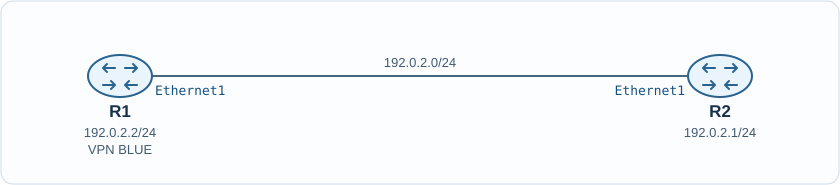

# VPN 实例与路由隔离 配置案例

## 拓扑



(case-conditions-04-ip-routing-vpn-instance)=
## 配置条件

规划实例名称、地址族及关联接口。如果接口已有地址，绑定或切换 VPN 后须按目标实例重新配置所需的地址。

## 配置步骤

```vortexros-config
ip vpn-instance BLUE
 ipv4-family
  route-distinguisher 65000:100
  vpn-target 65000:100 both
 ipv6-family
#
interface Ethernet 1
 ip binding vpn-instance BLUE
 ip address 192.0.2.2 255.255.255.0
#
return
```

录入并提交。仍有接口、路由或动态协议引用时，应先解除引用，再删除 VPN 实例。

(case-verification-04-ip-routing-vpn-instance)=
## 验证方法

对照以下命令和预期结果核对设备状态。

```vortexros-cli
display ip vpn-instance
display ip vpn-instance interface
display ip routing-table vpn-instance BLUE
```

确认 Ethernet1 属于 BLUE，并检查该路由表中的直连路径。从对应 VPN 发起连通性测试。
