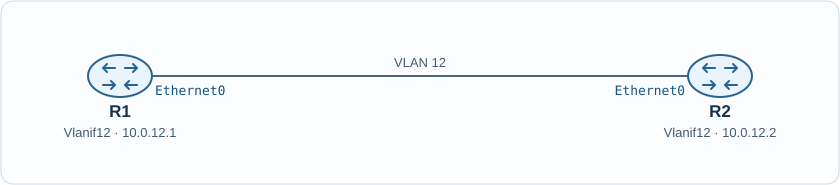

# 独立BFD会话

## 拓扑



## 配置条件

确保两端已经具有可用的三层路径。按链路条件确定计时及检测次数。

## 配置步骤

```text
bfd
bfd TO-P2 bind peer-ip 10.0.12.2 source-ip 10.0.12.1 interface Vlanif 12
 min-tx-interval 300
 min-rx-interval 300
 detect-multiplier 3
 log-session-changes
```

多跳会话需要显式指定 `source-ip`，VPN场景可追加 `vpn-instance BLUE`。

## 验证方法

对照{ref}`本功能页的实测结果 <recorded-result-05-dynamic-routing-bfd>`可以核对设备实际显示的字段或业务表现。不同拓扑请按本案例的地址和接口检查。

对照以下命令和预期结果核对设备状态。

```vortexros-cli
display bfd session all
display bfd statistics
```

对端配置镜像会话后，两端应 Up 且计数增加。断开并恢复链路时观察 Down 和重新建立。
