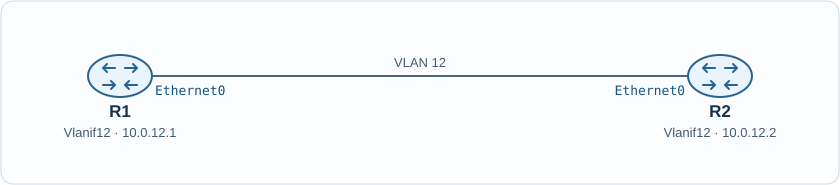

# 路由协议调用BFD

## 拓扑



## 配置条件

确保两端已经具有可用的三层路径。按链路条件确定计时及检测次数。

## 配置步骤

```text
interface Vlanif 12
 ospf bfd enable
 ospf bfd min-tx-interval 300 min-rx-interval 300 detect-multiplier 3
```

```text
bgp 64512
 peer 10.0.0.2 bfd enable
 peer 10.0.0.2 bfd min-tx-interval 300 min-rx-interval 300 detect-multiplier 3
```

IS-IS和RIP使用同样的接口形式，将命令前缀替换为 `isis bfd` 或 `rip bfd`。

```vortexros-cli
display bfd configuration
display bfd session all
display bfd statistics
```

恢复默认计时或删除会话：

```text
bfd TO-P2 bind peer-ip 10.0.12.2 source-ip 10.0.12.1 interface Vlanif 12
 undo min-tx-interval
 undo min-rx-interval
 undo detect-multiplier
undo bfd TO-P2
commit
```

## 验证方法

对照以下命令和预期结果核对设备状态。

```vortexros-cli
display bfd session all
display ospf peer brief
display bgp peer
```

对实际使用的协议打开 BFD 后，所配邻接出现 Up 会话。测试对应链路失效时状态关联，再验证恢复。
