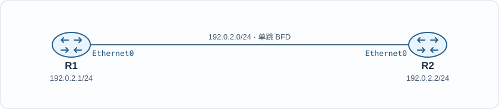

# 直连双端独立 BFD 会话

## 拓扑



## 配置条件

确保两端已经具有可用的三层路径。按链路条件确定计时及检测次数。

两个 Ethernet0 位于 192.0.2.0/24。两端本地地址和对端地址互换，检测间隔 300 ms、倍数 3。

## 配置步骤

两台设备分别在系统视图录入各自的配置片段，退出功能视图后提交。

**R1**

```vortexros-config
interface Ethernet 0
 ip address 192.0.2.1 255.255.255.0
#
bfd
#
bfd TO-R2 bind peer-ip 192.0.2.2 source-ip 192.0.2.1 interface Ethernet 0
 min-tx-interval 300
 min-rx-interval 300
 log-session-changes
#
return
```

**R2**

```vortexros-config
interface Ethernet 0
 ip address 192.0.2.2 255.255.255.0
#
bfd
#
bfd TO-R1 bind peer-ip 192.0.2.1 source-ip 192.0.2.2 interface Ethernet 0
 min-tx-interval 300
 min-rx-interval 300
 log-session-changes
#
return
```

## 验证方法

对照{ref}`本功能页的实测结果 <recorded-result-05-dynamic-routing-bfd>`可以核对设备实际显示的字段或业务表现。不同拓扑请按本案例的地址和接口检查。

对照以下命令和预期结果核对设备状态。

```vortexros-cli
display bfd session all
display bfd statistics
```

两端会话为 Up，发送和接收计数增加。受控断开链路并恢复时，记录 Down 和随后回到 Up 的过程。
