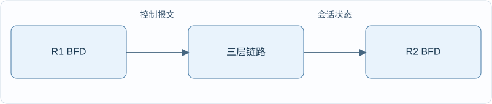

# OSPFv3 联动 BFD

## 拓扑



## 配置条件

确保两端已经具有可用的三层路径。按链路条件确定计时及检测次数。

复用 OSPFv3 双节点的 Ethernet0 链路与环回，每端在互联口开启动态 BFD。若有备用链路，先建立其 OSPFv3 邻接并将成本设高。

## 配置步骤

两台设备分别在系统视图录入各自的配置片段，退出功能视图后提交。

**R1**

```vortexros-config
bfd
#
ospfv3 1 router-id 198.51.100.1
 area 0.0.0.0
#
interface Ethernet 0
 ipv6 enable
 ipv6 address 2001:db8:12::1 64
 ospfv3 1 area 0.0.0.0
 ospfv3 bfd enable
 ospfv3 bfd min-tx-interval 300 min-rx-interval 300
#
interface LoopBack 0
 ipv6 enable
 ipv6 address 2001:db8:1::1 128
 ospfv3 1 area 0.0.0.0
#
return
```

**R2**

```vortexros-config
bfd
#
ospfv3 1 router-id 198.51.100.2
 area 0.0.0.0
#
interface Ethernet 0
 ipv6 enable
 ipv6 address 2001:db8:12::2 64
 ospfv3 1 area 0.0.0.0
 ospfv3 bfd enable
 ospfv3 bfd min-tx-interval 300 min-rx-interval 300
#
interface LoopBack 0
 ipv6 enable
 ipv6 address 2001:db8:2::1 128
 ospfv3 1 area 0.0.0.0
#
return
```

## 验证方法

对照以下命令和预期结果核对设备状态。

```vortexros-cli
display bfd session all
display ospfv3 1 peer brief
display ipv6 routing-table
```

主链路 BFD 为 Up，OSPFv3 为 Full。故障时检查主邻接退出，存在备用路径时远端路由下一跳应切至备用链路。恢复后检查会话、主路径和双向转发。
