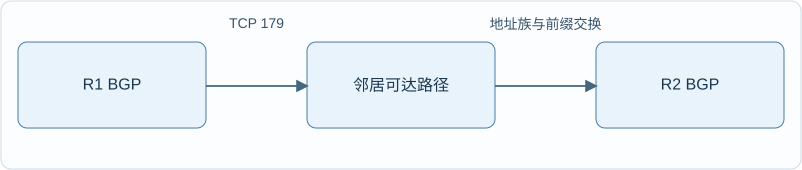

# 建立IPv4邻居

## 拓扑



## 配置条件

确保邻居地址可达，规划两端 AS、Router ID 以及要交换的前缀。部署应用策略前检查现有会话。

## 配置步骤

```text
bgp 64512
 router-id 10.0.0.1
 peer 10.0.0.2 as-number 64513
 peer 10.0.0.2 description EBGP-P2
 peer 10.0.0.2 connect-interface LoopBack 0
 peer 10.0.0.2 route-policy RP-IN import
 ipv4-family unicast
  network 10.10.0.0 255.255.0.0
```

提交后，设备使用指定源接口连接邻居，对收到的路由应用 `RP-IN`，并在本地路由表存在相同前缀时发布network。输入 `lo0` 等合法缩写时，配置会显示为设备中的规范接口名。

## 验证方法

对照{ref}`本功能页的实测结果 <recorded-result-05-dynamic-routing-bgp>`可以核对设备实际显示的字段或业务表现。不同拓扑请按本案例的地址和接口检查。

对照以下命令和预期结果核对设备状态。

```vortexros-cli
display bgp peer
display bgp routing-table
```

确认与 10.0.0.2 的会话建立，并核对进出前缀受策略影响的范围和下一跳。
