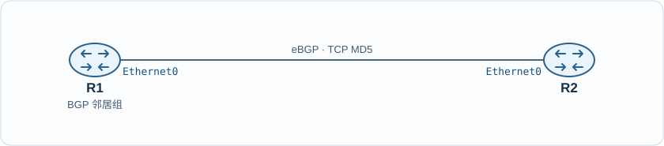

# 邻居组与TCP MD5认证

## 拓扑



## 配置条件

确保邻居地址可达，规划两端 AS、Router ID 以及要交换的前缀。部署应用策略前检查现有会话。

具有相同属性的邻居可以加入同一个邻居组。内部组继承本地AS；外部组必须先指定对端AS，再加入成员：

## 配置步骤

```text
bgp 64512
 group IBGP-RR internal
 peer IBGP-RR password simple Lab-Password-01
 peer IBGP-RR connect-interface LoopBack 0
 peer 10.0.0.2 group IBGP-RR
 peer 10.0.0.3 group IBGP-RR
 group TRANSIT external
 peer TRANSIT as-number 64513
 peer TRANSIT password simple Transit-Password-01
 peer 192.0.2.2 group TRANSIT
 ipv4-family unicast
  peer IBGP-RR reflect-client
  peer TRANSIT route-policy RP-IN import
```

命令关键字不区分大小写，邻居组名称按输入原样保存并区分大小写；`TRANSIT`与`transit`是两个不同对象。成员继承组的AS、认证、源接口及地址族策略。邻居可以用`peer ADDRESS password simple PASSWORD`设置自己的认证密码，以覆盖组密码。已经加入邻居组的成员不能再单独配置AS；需要改变归属时，应先执行`undo peer ADDRESS`，再重新创建。

BFD 计时器按字段继承。成员单独配置的计时字段覆盖组值，其余字段继续继承。`peer ADDRESS bfd disable` 停用该成员继承的 BFD，`undo peer ADDRESS bfd disable` 恢复继承。

BGP 使用 TCP MD5，两端应配置同一共享密钥。交互配置使用 `password simple`，保存的 CFG 使用设备密钥加密。跨设备迁移时在目标设备重新录入共享密钥。密码长度为 1–80 个非空格可打印字符。

邻居组不能在仍有成员引用时删除。可按以下顺序撤销：

```text
bgp 64512
 undo peer 192.0.2.2
 undo peer TRANSIT password
 undo group TRANSIT
commit
```

`display bgp group` 用于查看邻居组状态，`display current-configuration configuration bgp` 用于核对设备配置。普通 BGP 会话状态不显示密码。

## 验证方法

对照以下命令和预期结果核对设备状态。

```vortexros-cli
display bgp group
display bgp peer
```

核对邻居加入指定组，组和对端使用相符的共享密钥，邻居会话应为 Established。
