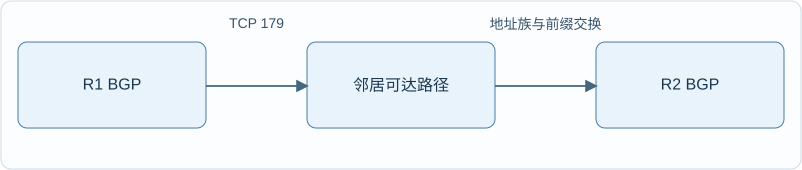

# VPN与IPv6地址族

## 拓扑



## 配置条件

确保邻居地址可达，规划两端 AS、Router ID 以及要交换的前缀。部署应用策略前检查现有会话。

## 配置步骤

```text
bgp 64512
 ipv4-family vpn-instance BLUE
  import-route direct
 ipv6-family vpn-instance BLUE
  import-route direct
```

VPN地址族使用VPN实例下配置的RD和RT。进入VPN地址族后，设备会加入该地址族需要的默认配置。`undo default ipv4-unicast`用于取消自动启用新IPv4邻居；此后需要在IPv4 unicast地址族中显式启用邻居。

在对应的 unicast 地址族下修改邻居。IPv6 邻居或 network 的策略应使用 `ip ipv6-prefix` 和 `if-match ipv6 address prefix-list`。IPv6 地址族中的 `import-route ospf` 导入 OSPFv3 路由。

地址族中可以生成聚合路由：

```text
bgp 64512
 ipv4-family unicast
  aggregate 10.0.0.0 255.0.0.0 detail-suppressed
 ipv6-family unicast
  aggregate 2001:db8:: 32 as-set detail-suppressed
```

`detail-suppressed` 只发布聚合路由。`as-set` 保留组成路由的 AS 信息。两项均未配置时，聚合路由与组成路由同时发布。

## 验证方法

对照以下命令和预期结果核对设备状态。

```vortexros-cli
display bgp vpnv4 vpn-instance BLUE routing-table
display ipv6 routing-table vpn-instance BLUE
```

核对进入对应地址族的可达前缀和聚合结果。只看对等体状态无法确认导入或发布是否符合预期。
