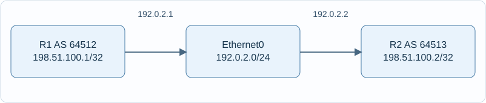

# 直连 eBGP 双向发布环回地址

## 拓扑



## 配置条件

确保邻居地址可达，规划两端 AS、Router ID 以及要交换的前缀。部署应用策略前检查现有会话。

R1 AS 64512 和 R2 AS 64513 通过 Ethernet0 的 192.0.2.0/24 直连。各自只发布本机 LoopBack0 的 /32。

## 配置步骤

两台设备分别在系统视图录入各自的配置片段，退出功能视图后提交。

**R1**

```vortexros-config
interface Ethernet 0
 ip address 192.0.2.1 255.255.255.0
#
interface LoopBack 0
 ip address 198.51.100.1 255.255.255.255
#
bgp 64512
 router-id 198.51.100.1
 peer 192.0.2.2 as-number 64513
 ipv4-family unicast
  peer 192.0.2.2 enable
  network 198.51.100.1 255.255.255.255
#
return
```

**R2**

```vortexros-config
interface Ethernet 0
 ip address 192.0.2.2 255.255.255.0
#
interface LoopBack 0
 ip address 198.51.100.2 255.255.255.255
#
bgp 64513
 router-id 198.51.100.2
 peer 192.0.2.1 as-number 64512
 ipv4-family unicast
  peer 192.0.2.1 enable
  network 198.51.100.2 255.255.255.255
#
return
```

## 验证方法

对照{ref}`本功能页的实测结果 <recorded-result-05-dynamic-routing-bgp>`可以核对设备实际显示的字段或业务表现。不同拓扑请按本案例的地址和接口检查。

对照以下命令和预期结果核对设备状态。

```vortexros-cli
display bgp peer
display bgp routing-table
display ip routing-table protocol bgp
```

两端邻居均为 Established。R1 的远端 198.51.100.2/32 下一跳应为 192.0.2.2，AS 路径应含 64513。R2 可观察反向结果。各自从环回发起对端测试。
