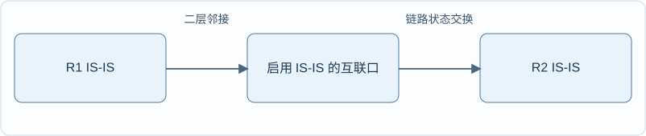

# 在指定 VPN 启用双栈 IS-IS

## 拓扑



## 配置条件

为每台设备分配唯一 NET 与 System ID，统一链路两端的 Level、计时和认证。

进程号在设备内全局唯一。一个进程只能绑定一个VPN，一个VPN最多配置一个IS-IS进程；接口所属VPN必须与进程VPN一致。

## 配置步骤

```text
isis 10 vpn-instance BLUE
 network-entity 49.0001.0100.0000.0001.00
 is-level level-2
 cost-style wide
 log-adjacency-changes
interface Vlanif 100
 isis enable 10
 isis ipv6-enable 10
 isis circuit-type p2p
 isis circuit-level level-2
 isis cost 20
```

提交后，IPv4和IPv6在同一进程中运行。接口VPN不一致、同一接口引用另一个进程或同一VPN已存在其他进程时，命令会被拒绝。

`import-route`用于导入IPv4路由，`ipv6 import-route`用于导入IPv6路由：

```text
isis 10
 import-route static
 ipv6 import-route static
 ipv6 import-route ospfv3
```

重分发按 IS-IS 进程的级别生效。默认的 Level-1-2 进程可向两个级别重分发。

```vortexros-cli
display isis 10 brief
display isis 10 peer
display isis 10 interface
display isis 10 lsdb
display isis 10 route
```

撤销示例：

```text
interface Vlanif 100
 undo isis ipv6-enable 10
 undo isis enable
undo isis 10
commit
```

如果需要把进程迁移到另一个VPN，应先删除进程，再使用新VPN重新创建。

## 验证方法

对照{ref}`本功能页的实测结果 <recorded-result-05-dynamic-routing-isis>`可以核对设备实际显示的字段或业务表现。不同拓扑请按本案例的地址和接口检查。

对照以下命令和预期结果核对设备状态。

```vortexros-cli
display isis 10 peer
display isis 10 interface
```

邻居应为 Level-2、Up，接口状态显示 IPv4 和 IPv6 可用。从 BLUE 路由表核对对应远端前缀。
