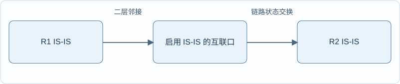

# Level-2 双栈邻接与路由

## 拓扑



## 配置条件

为每台设备分配唯一 NET 与 System ID，统一链路两端的 Level、计时和认证。

两台设备通过 Ethernet0 对接，使用 192.0.2.0/24 和 2001:db8:12::/64。每台设备具有独立的 NET 和双栈环回。

## 配置步骤

两台设备分别在系统视图录入各自的配置片段，退出功能视图后提交。

**R1**

```vortexros-config
isis 10
 network-entity 49.0001.0100.0000.0001.00
 is-level level-2
 cost-style wide
#
interface Ethernet 0
 ip address 192.0.2.1 255.255.255.0
 ipv6 enable
 ipv6 address 2001:db8:12::1 64
 isis enable 10
 isis ipv6-enable 10
 isis circuit-type p2p
 isis circuit-level level-2
#
interface LoopBack 0
 ip address 198.51.100.1 255.255.255.255
 ipv6 enable
 ipv6 address 2001:db8:1::1 128
 isis enable 10
 isis ipv6-enable 10
#
return
```

**R2**

```vortexros-config
isis 10
 network-entity 49.0001.0100.0000.0002.00
 is-level level-2
 cost-style wide
#
interface Ethernet 0
 ip address 192.0.2.2 255.255.255.0
 ipv6 enable
 ipv6 address 2001:db8:12::2 64
 isis enable 10
 isis ipv6-enable 10
 isis circuit-type p2p
 isis circuit-level level-2
#
interface LoopBack 0
 ip address 198.51.100.2 255.255.255.255
 ipv6 enable
 ipv6 address 2001:db8:2::1 128
 isis enable 10
 isis ipv6-enable 10
#
return
```

## 验证方法

对照{ref}`本功能页的实测结果 <recorded-result-05-dynamic-routing-isis>`可以核对设备实际显示的字段或业务表现。不同拓扑请按本案例的地址和接口检查。

对照以下命令和预期结果核对设备状态。

```vortexros-cli
display isis 10 peer
display isis 10 interface
display ip routing-table protocol isis
display ipv6 routing-table protocol isis
```

邻居为 Level-2、Up，Ethernet0 的 IPv4 与 IPv6 均已启用。R1 应看到 198.51.100.2/32 与 2001:db8:2::1/128，R2 应看到对称的路由。
