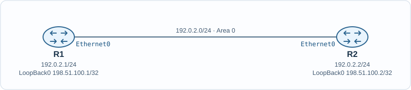

# 两台设备建立 Area 0 邻接

## 拓扑



## 配置条件

为每台路由器选独立的 Router ID。检查链路地址、区域、网络类型和计时两端一致。

R1 Ethernet0 192.0.2.1/24 直连 R2 Ethernet0 192.0.2.2/24。两端通告各自 LoopBack0 的 198.51.100.1/32 和 198.51.100.2/32。

## 配置步骤

两台设备分别在系统视图录入各自的配置片段，退出功能视图后提交。

**R1**

```vortexros-config
ospf 1 router-id 198.51.100.1
 area 0.0.0.0
#
interface Ethernet 0
 ip address 192.0.2.1 255.255.255.0
 ospf enable 1 area 0.0.0.0
 ospf network-type p2p
#
interface LoopBack 0
 ip address 198.51.100.1 255.255.255.255
 ospf enable 1 area 0.0.0.0
#
return
```

**R2**

```vortexros-config
ospf 1 router-id 198.51.100.2
 area 0.0.0.0
#
interface Ethernet 0
 ip address 192.0.2.2 255.255.255.0
 ospf enable 1 area 0.0.0.0
 ospf network-type p2p
#
interface LoopBack 0
 ip address 198.51.100.2 255.255.255.255
 ospf enable 1 area 0.0.0.0
#
return
```

## 验证方法

对照{ref}`本功能页的实测结果 <recorded-result-05-dynamic-routing-ospf>`可以核对设备实际显示的字段或业务表现。不同拓扑请按本案例的地址和接口检查。

对照以下命令和预期结果核对设备状态。

```vortexros-cli
display ospf 1 peer brief
display ospf 1 interface
display ip routing-table protocol ospf
```

两端 Area 均为 0.0.0.0，邻居为 Full。R1 应看到 198.51.100.2/32 的 OSPF 路由，下一跳为 192.0.2.2。R2 应看到相反方向的路由。从 R1 ping 198.51.100.2 核对转发。
