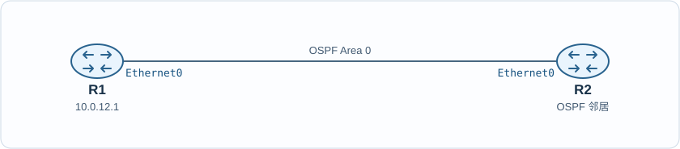

# 使用area下的network激活

## 拓扑



## 配置条件

为每台路由器选独立的 Router ID。检查链路地址、区域、网络类型和计时两端一致。

## 配置步骤

```text
ospf 1 router-id 10.0.0.1
 opaque-capability enable
 area 0.0.0.0
  network 10.0.12.1 0.0.0.0 description P1-P2
```

`network`只能在area视图中输入。提交后，地址匹配的接口开始发送Hello报文；只有两端area、网络类型、认证和计时等条件兼容时才会建立邻居。

## 验证方法

对照{ref}`本功能页的实测结果 <recorded-result-05-dynamic-routing-ospf>`可以核对设备实际显示的字段或业务表现。不同拓扑请按本案例的地址和接口检查。

对照以下命令和预期结果核对设备状态。

```vortexros-cli
display ospf 1 interface
display ospf 1 peer brief
```

在两端确认 Area 0 中实际加入的是 network 所匹配的接口，并核对邻接达到 Full。
