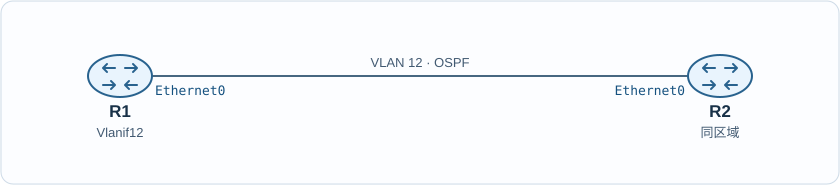

# 使用接口命令激活

## 拓扑



## 配置条件

为每台路由器选独立的 Router ID。检查链路地址、区域、网络类型和计时两端一致。

## 配置步骤

```text
ospf 1 router-id 10.0.0.1
interface Vlanif 12
 ospf enable 1 area 0.0.0.0
 ospf network-type p2p
 ospf cost 10
 ospf dr-priority 100
```

同一进程只能选择 `network` 或接口 `ospf enable` 一种激活方式；混用会在命令进入待提交配置前报错。广播网络上的DR优先级范围为0至255，0表示不参与DR/BDR选举。

## 验证方法

对照{ref}`本功能页的实测结果 <recorded-result-05-dynamic-routing-ospf>`可以核对设备实际显示的字段或业务表现。不同拓扑请按本案例的地址和接口检查。

对照以下命令和预期结果核对设备状态。

```vortexros-cli
display ospf 1 interface
display ospf 1 peer brief
```

核对配置中的 Vlanif12 加入 Area 0，另一端模式一致后检查邻居达到 Full。
