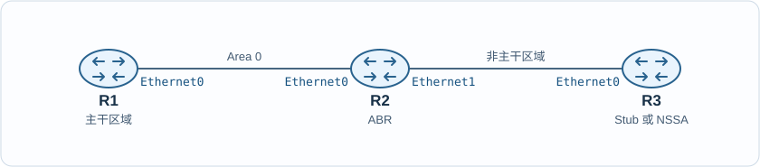

# Stub、NSSA与区域汇总

## 拓扑



## 配置条件

为每台路由器选独立的 Router ID。检查链路地址、区域、网络类型和计时两端一致。

区域类型和汇总在area视图配置：

## 配置步骤

```text
ospf 1
 area 0.0.0.1
  nssa no-summary
  abr-summary 10.0.0.0 255.0.0.0 not-advertise
```

`stub`与`nssa`互斥；已经配置一种类型时，必须先执行对应的`undo`，不能用另一条命令隐式覆盖。`no-summary`阻止向该区域发布三类汇总路由，`not-advertise`阻止发布指定区域汇总。撤销命令为`undo stub`、`undo nssa`和`undo abr-summary ADDRESS MASK`。

## 验证方法

对照以下命令和预期结果核对设备状态。

```vortexros-cli
display ospf 1 lsdb
display ospf 1 peer brief
```

在区域另一端查看选定区域的 LSA，核对配置的汇总已按预期发布或被抑制，邻接仍然稳定。
