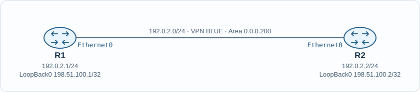

# 在管理 VPN 内建立独立 OSPF 邻居

## 拓扑



## 配置条件

为每台路由器选独立的 Router ID。检查链路地址、区域、网络类型和计时两端一致。

沿用 [Area 0 邻接案例](area-zero-adjacency.md) 的物理连线。在独立配置中把两个接口都放入 BLUE，进程改为 2，区域改为 0.0.0.200。

## 配置步骤

两台设备分别在系统视图录入各自的配置片段，退出功能视图后提交。

**R1**

```vortexros-config
ip vpn-instance BLUE
 ipv4-family
#
ospf 2 router-id 198.51.100.1 vpn-instance BLUE
 area 0.0.0.200
#
interface Ethernet 0
 ip binding vpn-instance BLUE
 ip address 192.0.2.1 255.255.255.0
 ospf enable 2 area 0.0.0.200
 ospf network-type p2p
#
interface LoopBack 0
 ip binding vpn-instance BLUE
 ip address 198.51.100.1 255.255.255.255
 ospf enable 2 area 0.0.0.200
#
return
```

**R2**

```vortexros-config
ip vpn-instance BLUE
 ipv4-family
#
ospf 2 router-id 198.51.100.2 vpn-instance BLUE
 area 0.0.0.200
#
interface Ethernet 0
 ip binding vpn-instance BLUE
 ip address 192.0.2.2 255.255.255.0
 ospf enable 2 area 0.0.0.200
 ospf network-type p2p
#
interface LoopBack 0
 ip binding vpn-instance BLUE
 ip address 198.51.100.2 255.255.255.255
 ospf enable 2 area 0.0.0.200
#
return
```

## 验证方法

对照以下命令和预期结果核对设备状态。

```vortexros-cli
display ospf 2 peer brief
display ip routing-table vpn-instance BLUE protocol ospf
```

进程 2 中邻居达到 Full。远端环回应出现在 BLUE 路由表。从 R1 执行 `ping -vpn-instance BLUE 198.51.100.2` 检查。
