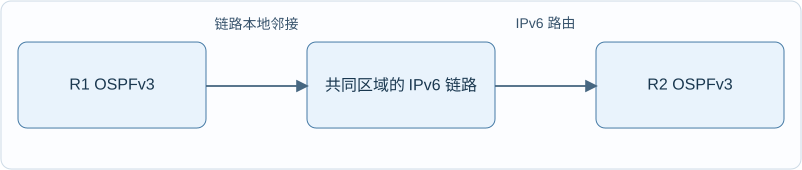

# 配置进程、区域及接口

## 拓扑



## 配置条件

准备 IPv6 上联、非重复的 Router ID 和两端相同的区域。

OSPFv3用于IPv6动态路由。先创建进程和区域，再在三层接口下绑定进程：

## 配置步骤

```text
ospfv3 1 router-id 10.0.0.1
 maximum load-balancing 6
 bandwidth-reference 100000
 import-route static
 area 0.0.0.0
interface Vlanif 12
 ospfv3 1 area 0.0.0.0
```

接口必须属于与进程相同的 VPN 实例。进程 1 使用默认路由表，其他进程必须在创建时指定非默认 VPN，例如 `ospfv3 2 router-id 10.0.0.2 vpn-instance BLUE`。每个 VPN 只能配置一个 OSPFv3 进程。

Stub、NSSA和IPv6区域汇总在area视图配置：

```text
ospfv3 1
 area 0.0.0.1
  nssa no-summary
  abr-summary 2001:db8:: 32 not-advertise
```

`stub`与`nssa`互斥。`default-route-advertise`仅在本机已有IPv6默认路由时发布，`default-route-advertise always`则不依赖本机默认路由。`silent-interface INTERFACE`保留该接口的网络发布但停止建立邻居。

```vortexros-cli
display ospfv3 1 brief
display ospfv3 1 peer brief
display ospfv3 1 interface
display ospfv3 1 lsdb
display ospfv3 1 routing
```

`peer brief` 显示当前邻接，`routing` 显示 OSPFv3 学到的路由。正常时应同时确认邻居为 Full、目标 IPv6 路由存在并可达。

撤销示例：

```text
interface Vlanif 12
 undo ospfv3 1 area 0.0.0.0
ospfv3 1
 area 0.0.0.1
  undo abr-summary 2001:db8:: 32
  undo nssa
undo ospfv3 1
commit
```

## 验证方法

对照{ref}`本功能页的实测结果 <recorded-result-05-dynamic-routing-ospfv3>`可以核对设备实际显示的字段或业务表现。不同拓扑请按本案例的地址和接口检查。

对照以下命令和预期结果核对设备状态。

```vortexros-cli
display ospfv3 1 peer brief
display ospfv3 1 routing
```

确认接口加入选定 Area，邻居为 Full，路由列表出现对端前缀。验证 Stub 或 NSSA 时另看区域的实际 LSA 发布。
