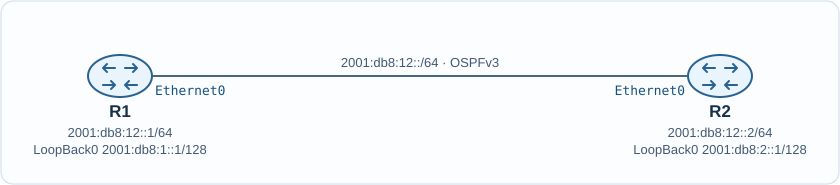

# 双节点 OSPFv3 发布 IPv6 环回

## 拓扑



## 配置条件

准备 IPv6 上联、非重复的 Router ID 和两端相同的区域。

R1 和 R2 以 Ethernet0 直连，分别使用 2001:db8:12::1/64 和 ::2/64。两端在同一区域发布不同的 IPv6 环回。

## 配置步骤

两台设备分别在系统视图录入各自的配置片段，退出功能视图后提交。

**R1**

```vortexros-config
ospfv3 1 router-id 198.51.100.1
 area 0.0.0.0
#
interface Ethernet 0
 ipv6 enable
 ipv6 address 2001:db8:12::1 64
 ospfv3 1 area 0.0.0.0
#
interface LoopBack 0
 ipv6 enable
 ipv6 address 2001:db8:1::1 128
 ospfv3 1 area 0.0.0.0
#
return
```

**R2**

```vortexros-config
ospfv3 1 router-id 198.51.100.2
 area 0.0.0.0
#
interface Ethernet 0
 ipv6 enable
 ipv6 address 2001:db8:12::2 64
 ospfv3 1 area 0.0.0.0
#
interface LoopBack 0
 ipv6 enable
 ipv6 address 2001:db8:2::1 128
 ospfv3 1 area 0.0.0.0
#
return
```

## 验证方法

对照{ref}`本功能页的实测结果 <recorded-result-05-dynamic-routing-ospfv3>`可以核对设备实际显示的字段或业务表现。不同拓扑请按本案例的地址和接口检查。

对照以下命令和预期结果核对设备状态。

```vortexros-cli
display ospfv3 1 peer brief
display ospfv3 1 routing
display ipv6 routing-table
```

两端均看到对方 Router ID，邻接为 Full。R1 应学到 2001:db8:2::1/128，下一跳通常为对端链路本地地址。用 IPv6 ping 验证远端环回。
