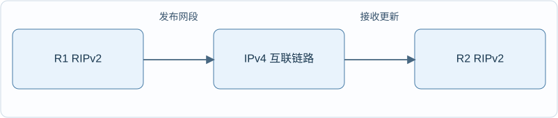

# 配置网络与更新计时

## 拓扑



## 配置条件

在同一 IPv4 链路上配置兼容的 RIP 版本并准备要通告的网段。

## 配置步骤

```text
rip 1
 version 2
 network 10.0.0.0
 default-metric 2
 maximum load-balancing 4
 timers rip 30 180 120
 silent-interface LoopBack 0
```

`network`使用IPv4主类网络地址。提交后匹配接口参加RIP，silent-interface仍发布该接口网络，但不从该接口发送更新。

## 验证方法

对照{ref}`本功能页的实测结果 <recorded-result-05-dynamic-routing-rip>`可以核对设备实际显示的字段或业务表现。不同拓扑请按本案例的地址和接口检查。

对照以下命令和预期结果核对设备状态。

```vortexros-cli
display rip 1 interface
display rip 1 database
```

确认匹配 10.0.0.0 的接口参与更新。两端计时兼容时应能看到对端通告的前缀。
