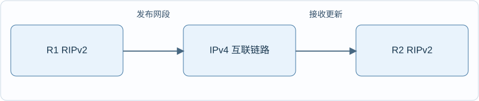

# RIPv2 两端交换 IPv4 前缀

## 拓扑



## 配置条件

在同一 IPv4 链路上配置兼容的 RIP 版本并准备要通告的网段。

R1 和 R2 运行在同一个 10.0.0.0/8 主类网络中的不同子网。互联链路为 10.12.0.0/24，环回地址分别为 10.255.0.1/32 和 10.255.0.2/32。

## 配置步骤

两台设备分别在系统视图录入各自的配置片段，退出功能视图后提交。

**R1**

```vortexros-config
interface Ethernet 0
 ip address 10.12.0.1 255.255.255.0
#
interface LoopBack 0
 ip address 10.255.0.1 255.255.255.255
#
rip 1
 version 2
 network 10.0.0.0
 silent-interface LoopBack 0
#
return
```

**R2**

```vortexros-config
interface Ethernet 0
 ip address 10.12.0.2 255.255.255.0
#
interface LoopBack 0
 ip address 10.255.0.2 255.255.255.255
#
rip 1
 version 2
 network 10.0.0.0
 silent-interface LoopBack 0
#
return
```

## 验证方法

对照以下命令和预期结果核对设备状态。

```vortexros-cli
display rip 1 interface
display rip 1 database
display ip routing-table protocol rip
```

Ethernet0 发送并接收 RIPv2 更新，环回保留通告但不发更新。R1 应学到经 10.12.0.2 的 10.255.0.2/32。删除对端的 RIP 进程后，该学习路由应被撤销。
