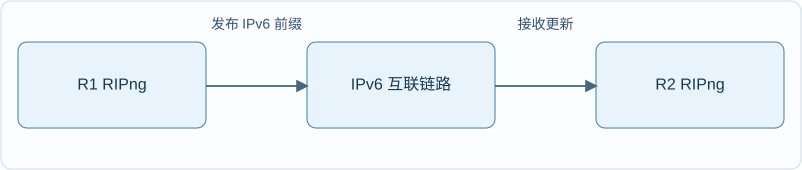

# 配置 VPN 实例的 RIPng

## 拓扑



## 配置条件

准备已配置 IPv6 的链路。如果使用 BLUE，先创建并配置相应的 IPv6 VPN 实例。

## 配置步骤

```text
ripng 2 vpn-instance BLUE
 network 2001:db8:100::/64
 import-route static
 default-route originate
```

RIPng 视图中的 `import-route ospf` 导入 OSPFv3 路由。

```vortexros-cli
display rip 1 interface
display rip 1 database
display rip 1 route
display ripng 2 interface
display ripng 2 route
```

精确撤销：

```text
rip 1
 undo network 10.0.0.0
 undo timers rip
undo rip 1
undo ripng 2 vpn-instance BLUE
commit
```

如需移除 IPv4 RIP 进程，请参见 [RIP（IPv4）](../../rip.md)。

## 验证方法

对照{ref}`本功能页的实测结果 <recorded-result-05-dynamic-routing-ripng>`可以核对设备实际显示的字段或业务表现。不同拓扑请按本案例的地址和接口检查。

对照以下命令和预期结果核对设备状态。

```vortexros-cli
display ripng 2 route
display ipv6 routing-table vpn-instance BLUE
```

邻居发出更新后，核对 BLUE 收到的网段、下一跳及接口。删除进程后，学到的路径应退出。
