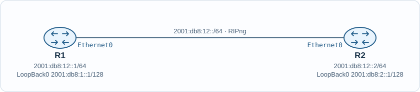

# RIPng 两端交换 IPv6 环回

## 拓扑



## 配置条件

准备已配置 IPv6 的链路。如果使用 BLUE，先创建并配置相应的 IPv6 VPN 实例。

R1 与 R2 的 Ethernet0 接入 2001:db8:12::/64。各自通告 LoopBack0 的 /128。

## 配置步骤

两台设备分别在系统视图录入各自的配置片段，退出功能视图后提交。

**R1**

```vortexros-config
interface Ethernet 0
 ipv6 enable
 ipv6 address 2001:db8:12::1 64
#
interface LoopBack 0
 ipv6 enable
 ipv6 address 2001:db8:1::1 128
#
ripng 2
 network 2001:db8:12::/64
 network 2001:db8:1::1/128
#
return
```

**R2**

```vortexros-config
interface Ethernet 0
 ipv6 enable
 ipv6 address 2001:db8:12::2 64
#
interface LoopBack 0
 ipv6 enable
 ipv6 address 2001:db8:2::1 128
#
ripng 2
 network 2001:db8:12::/64
 network 2001:db8:2::1/128
#
return
```

## 验证方法

对照{ref}`本功能页的实测结果 <recorded-result-05-dynamic-routing-ripng>`可以核对设备实际显示的字段或业务表现。不同拓扑请按本案例的地址和接口检查。

对照以下命令和预期结果核对设备状态。

```vortexros-cli
display ripng 2 interface
display ripng 2 route
display ipv6 routing-table protocol ripng
```

R1 应学到 2001:db8:2::1/128，下一跳为 R2 的链路本地地址，R2 可看到相反方向的路由。若撤销其中一个 network，等待更新后确认相应路由消失。
