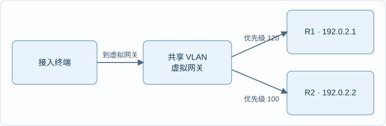

# 双栈 VRRPv3 单播网关

## 拓扑



## 配置条件

两台设备接在同一二层网段，使用不同真实地址、相同 VRID 和虚拟地址。启用跟踪前配置被跟踪接口。

R1、R2 和客户端连到同一个接入交换机。两台设备都用 Ethernet0，真实 IPv4 为 192.0.2.1/24 和 192.0.2.2/24。先用 `display ipv6 interface Ethernet0` 查出两个真实链路本地地址，再把下例 fe80::1 和 fe80::2 换成实测值。客户端用 192.0.2.254 和 fe80::fe 作为默认网关。

## 配置步骤

两台设备分别在系统视图录入各自的配置片段，退出功能视图后提交。

**R1**

```vortexros-config
vrrp version v3
#
interface Ethernet 0
 ip address 192.0.2.1 255.255.255.0
 ipv6 enable
 ipv6 address 2001:db8:12::1 64
 vrrp vrid 10 virtual-ip 192.0.2.254
 vrrp vrid 10 priority 120
 vrrp vrid 10 peer-ip 192.0.2.2
 vrrp6 vrid 20 virtual-ip fe80::fe
 vrrp6 vrid 20 virtual-ip 2001:db8:12::fe
 vrrp6 vrid 20 priority 120
 vrrp6 vrid 20 peer-ip fe80::2
#
return
```

**R2**

```vortexros-config
vrrp version v3
#
interface Ethernet 0
 ip address 192.0.2.2 255.255.255.0
 ipv6 enable
 ipv6 address 2001:db8:12::2 64
 vrrp vrid 10 virtual-ip 192.0.2.254
 vrrp vrid 10 peer-ip 192.0.2.1
 vrrp6 vrid 20 virtual-ip fe80::fe
 vrrp6 vrid 20 virtual-ip 2001:db8:12::fe
 vrrp6 vrid 20 peer-ip fe80::1
#
return
```

## 验证方法

在采用同一广播域的实测中，两端 VRRP 网关位于 `Vlanif200`，设备 IPv4 地址为 `198.51.100.1`、`198.51.100.2`，优先级分别为 120、105。虚拟地址为 `198.51.100.254`、`fe80::fe`、`2001:db8:200::fe`。在接入交换机上使用 VLAN 200，查询命令中的接口替换为 `Vlanif200`。

P1 的接入失效后，P2 开始向 P1 的实际地址发送双栈单播通告，客户端两族探测各收到 3/3。接回链路并恢复优先级后，P1 重任主机，两个方向的通告和网关可达性也恢复。两端撤销单播对端后，线上再次观察到 IPv4 `224.0.0.18` 和 IPv6 `ff02::12` 通告。

对照{ref}`本功能页的实测结果 <recorded-result-05-dynamic-routing-vrrp>`可以核对设备实际显示的字段或业务表现。不同拓扑请按本案例的地址和接口检查。

对照以下命令和预期结果核对设备状态。

```vortexros-cli
display vrrp brief
display vrrp6 brief
display vrrp statistics
```

正常时 R1 为 Master、运行优先级 120，R2 为 Backup、运行优先级 100。从客户端持续访问两端已可达的下游地址，关闭 R1 的接入口后，应看到 R2 接管两个虚拟网关，客户端业务恢复。恢复 R1 后检查抢占。若把某端的虚拟地址配置成该端真实地址，另用独立用例核对地址拥有者的运行优先级为 255。
