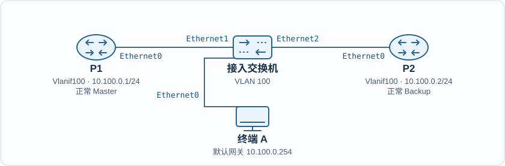

# IPv4完整示例

## 拓扑



## 配置条件

两台设备接在同一二层网段，使用不同真实地址、相同 VRID 和虚拟地址。启用跟踪前配置被跟踪接口。

假设P1与P2都连接到VLAN 100，客户端使用 `10.100.0.254`作为默认网关。P1优先级120作为Master，P2保持默认优先级100作为Backup。

## 配置步骤

P1：

```text
interface Vlanif 100
 ip address 10.100.0.1 255.255.255.0
 vrrp vrid 10 virtual-ip 10.100.0.254
 vrrp vrid 10 priority 120
 vrrp vrid 10 timer advertise 1
 vrrp vrid 10 track interface Vlanif 200 reduced 30
```

P2：

```text
interface Vlanif 100
 ip address 10.100.0.2 255.255.255.0
 vrrp vrid 10 virtual-ip 10.100.0.254
 vrrp vrid 10 timer advertise 1
```

IPv4 用首条 `virtual-ip` 创建组。默认优先级为 100、通告间隔为 1 秒、抢占开启。在 P1 已配置的 Vlanif200 断开后，P1 的运行优先级降低 30。若低于 P2，P2 接管虚拟网关。

需要 IPv4 VRRPv3 时，在两端系统视图执行 `vrrp version v3` 并提交。用 `undo vrrp version` 恢复 IPv4 的 v2 默认值。此前保存的按组 v3 配置仍可回放。单播要求 v3，通过 `peer-ip` 配置同链路对端真实地址。IPv6 单播使用对端链路本地地址。删除某个地址族的最后一个对端后，该族恢复组播。

虚拟IP可以与接口自身地址相同。此时设备是该虚拟地址的地址拥有者，运行优先级自动为255；配置中仍保留用户输入的优先级，状态显示以运行优先级为准。

## 验证方法

对照以下命令和预期结果核对设备状态。

```vortexros-cli
display vrrp brief
display vrrp interface Vlanif 100
```

Vlanif100 应显示相同 VRID 及虚拟地址。P1 正常时为 Master，将被跟踪接口关闭后核对 P2 接管。
