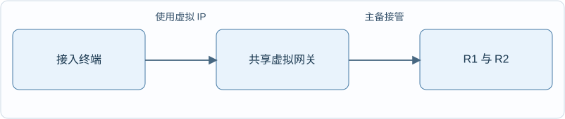

# IPv6示例

## 拓扑



## 配置条件

两台设备接在同一二层网段，使用不同真实地址、相同 VRID 和虚拟地址。启用跟踪前配置被跟踪接口。

## 配置步骤

```text
interface Vlanif 100
 ipv6 address 2001:db8:100::1 64
 vrrp6 vrid 20 virtual-ip fe80::fe
 vrrp6 vrid 20 virtual-ip 2001:db8:100::fe
 vrrp6 vrid 20 priority 120
 vrrp6 vrid 20 timer advertise 1
```

两端使用相同的 VRID 和虚拟地址。IPv6 的全局虚拟地址可与链路本地虚拟地址同组使用。

## 验证方法

对照{ref}`本功能页的实测结果 <recorded-result-05-dynamic-routing-vrrp>`可以核对设备实际显示的字段或业务表现。不同拓扑请按本案例的地址和接口检查。

对照以下命令和预期结果核对设备状态。

```vortexros-cli
display vrrp6 brief
```

两端应显示相同 VRID 与虚拟地址，对端使用不同的真实 IPv6 地址。确认一端 Master、一端 Backup，再从终端验证虚拟网关。
