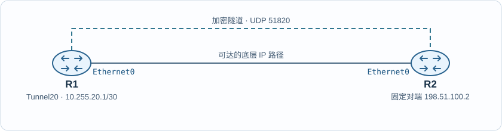

# 使用指定握手参数的对端

## 拓扑



## 配置条件

为两端准备独立密钥、可达的外层路径及相同的协议参数。外层 UDP 监听端口应符合部署规划。

AmneziaWG使用独立的数据面插件、接口和peer对象，不替换WireGuard；两类隧道可以同时配置。Profile除peer外，还保存握手前垃圾包、报文前置填充、消息头范围、内容填充、随机尾部和定时参数。两端必须使用一致的协议参数。

## 配置步骤

下面示例启用3个随机垃圾包、不同消息头范围和固定前置填充。启用header protection时，四类报文的前置填充都必须不少于12字节。

```text
amneziawg profile AWG-PROFILE
 junk size 16 48
 junk count 3
 padding init 24
 padding response 28
 padding cookie 20
 padding transport 16
 header init 100 110
 header response 200 210
 header cookie 300 310
 header transport 400 410
 padding content 4 16
 timing rekey-timeout 4 6
 header-protection BASE64-32-BYTE-KEY
 random-trailers enable
 junk-packet 1 expression "<b 0x160301><c><t><r 32><rc 16><rd 8>"
 #
 peer SITE-B
  publickey BASE64-PUBLIC-KEY
  allowd-ip 10.30.0.0 16
  destination 198.51.100.2 port 51820
  keepalive 25
#
interface Tunnel 20
 tunnel-protocol amneziawg
 privatekey auto
 source vpn-instance default
 amneziawg-profile AWG-PROFILE
 mtu 1500
 ip address 10.255.20.1 255.255.255.252
commit
```

`junk-packet SLOT BASE64`用于配置1至5号静态原始报文槽位；`junk-packet SLOT expression "EXPRESSION"`用于动态生成握手前报文。表达式支持：`<b 0x...>`固定字节、`<c>`每次握手随机起始且逐槽递增的32位网络序计数、`<t>`当前Unix秒、`<r N>`随机字节、`<rc N>`随机英文字母和`<rd N>`随机数字。表达式最多4096字节，展开后的单个报文最多4096字节，动态标签最多128个Jc/Jmin/Jmax产生的随机垃圾包与这些槽位相互独立。

Allowed IP、underlay VPN、动态客户端源端口、固定服务端监听端口和漫游endpoint的语义与WireGuard相同。Tunnel直连前缀会按Allowed IP最长前缀映射到peer，非直连业务网段仍由路由配置决定。修改协议参数时，已存在的peer会被最小化重建；修改单个peer只影响该peer。

验证命令：

```vortexros-cli
display amneziawg profile AWG-PROFILE
display amneziawg peer AWG-PROFILE SITE-B
display amneziawg interface Tunnel 20
display interface Tunnel 20
ping 10.255.20.2
```

删除时先解除Tunnel引用，再删除profile：

```text
interface Tunnel 20
 undo amneziawg-profile
quit
undo amneziawg profile AWG-PROFILE
commit
```

## 验证方法

对照{ref}`本功能页的实测结果 <recorded-result-06-tunnels-amneziawg>`可以核对设备实际显示的字段或业务表现。不同拓扑请按本案例的地址和接口检查。

对照以下命令和预期结果核对设备状态。

```vortexros-cli
display amneziawg interface Tunnel 20
display amneziawg peer AWG-PROFILE SITE-B
```

两端参数一致后向远端业务发送流量，预期出现握手以及收发计数，并验证 Tunnel 与远端业务都可达。
