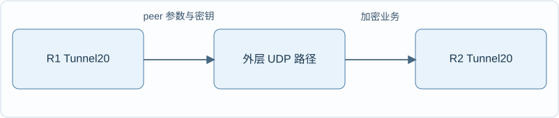

# 主动连接端与漫游应答端

## 拓扑



## 配置条件

为两端准备独立密钥、可达的外层路径及相同的协议参数。外层 UDP 监听端口应符合部署规划。

两台设备以 192.0.2.0/24 互联，R2 的外层地址为 192.0.2.2，底层也可改为经路由器可达。R1 主动发送，R2 固定监听 UDP 3443，从经过认证的流量学习 R1 端点。隧道地址分别为 10.44.0.1/30 和 .2/30。

## 配置步骤

两端先创建 Tunnel20，指定 `tunnel-protocol amneziawg`，执行 `privatekey auto` 并提交一次。用 `display current-configuration` 查看本机公钥，只交换公钥。把以下公钥占位符换成对端公钥，录入其余配置并提交。

**R1**

```text
amneziawg profile AWG
 junk size 16 48
 junk count 3
 peer R2
  publickey R2-PUBLIC-KEY
  allowd-ip 10.44.0.2 32
  destination 192.0.2.2 port 3443
  keepalive 15
#
interface Tunnel 20
 tunnel-protocol amneziawg
 source vpn-instance default
 amneziawg-profile AWG
 ip address 10.44.0.1 255.255.255.252
```

**R2**

```text
amneziawg profile AWG
 junk size 16 48
 junk count 3
 peer R1
  publickey R1-PUBLIC-KEY
  allowd-ip 10.44.0.1 32
#
interface Tunnel 20
 tunnel-protocol amneziawg
 source vpn-instance default
 source-port 3443
 amneziawg-profile AWG
 ip address 10.44.0.2 255.255.255.252
```

## 验证方法

对照{ref}`本功能页的实测结果 <recorded-result-06-tunnels-amneziawg>`可以核对设备实际显示的字段或业务表现。不同拓扑请按本案例的地址和接口检查。

对照以下命令和预期结果核对设备状态。

```vortexros-cli
display amneziawg interface
display interface Tunnel 20
display ip routing-table
```

R1 发起到 10.44.0.2 的 ping 后，两端应能看到握手时间更新与收发计数增长。再从 R2 测试回程。外层通过静态路由到达 R2 时，撤销并恢复该路由，确认外层可达后隧道重新握手。 AmneziaWG 的垃圾包和其他握手参数应在两端使用一致的值。
