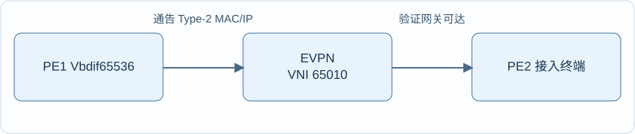

(section-operator-06-tunnels-evpn-gateway-1)=
# EVPN Vbdif 网关通告

<span id="overview"></span>

Vbdif 可向远端 VTEP 通告双栈网关的 MAC/IP。

<span id="principles"></span>

(section-operator-06-tunnels-evpn-gateway-2)=
## 工作原理

Vbdif 网关参与发布时，远端从 EVPN Type-2 识别具体网关 MAC/IP。普通网关和 Anycast 的配置用途不同。撤销前后需核对远端 MAC/IP 路由与客户实际转发。

Vbdif 可在 EVPN 中通告网关 MAC/IP。配置分布式网关时，提供该网关的 PE 使用一致的逻辑网关地址。

<span id="examples"></span>

(section-operator-06-tunnels-evpn-gateway-3)=
## 配置与验证

(section-operator-06-tunnels-evpn-gateway-4)=
### 拓扑



(case-conditions-06-tunnels-evpn-gateway)=
### 配置条件

沿用[高位 BD 的动态 VXLAN](vxlan-evpn.md) 双端配置。PE1 承载 Vbdif65536，PE2 的终端与它使用同一业务前缀。

(section-operator-06-tunnels-evpn-gateway-5)=
### 配置步骤

PE1 加入这段接口配置并提交。PE2 保留原有 BD/VNI 和接入口，终端设置 203.0.113.12/24 与 2001:db8:43::12/64。

```vortexros-config
bridge-domain 65536
#
interface Vbdif 65536
 mac-address 02:76:81:43:00:fe
 ip address 203.0.113.254 255.255.255.0
 ipv6 enable
 ipv6 address 2001:db8:43::fe 64
#
return
```

如果部署的是分布式 Anycast 网关，在每台提供该网关的 PE 上使用一致的网关 MAC 和地址，并在该 Vbdif 视图追加 `vxlan anycast-gateway enable`。

(case-verification-06-tunnels-evpn-gateway)=
### 验证方法

对照以下命令和预期结果核对设备状态。

```vortexros-cli
display interface Vbdif 65536
display bgp evpn all routing-table mac-route
display mac-address bridge-domain 65536
```

PE1 的网关接口应为 up，PE2 应能查询到通告的两条 Type-2 MAC/IP 路径，终端应可访问两个网关地址。从 PE1 删除网关并提交后，核对 PE2 不再看到该设备发布的 MAC/IP。

<span id="observed"></span>

(section-operator-06-tunnels-evpn-gateway-6)=
### 普通网关与 Anycast 网关的实测结果

三台 VTEP 的签名开发镜像验证覆盖普通及 Anycast Vbdif。两种网关的 IPv4、IPv6 Type-2 通告均可发布和撤销。普通 Vbdif 另外验证了远端双栈报文及路由服务重启后重新通告。

<span id="precautions"></span>

(section-operator-06-tunnels-evpn-gateway-7)=
## 注意事项

路由通告依赖正确的 BD、VNI 和 EVPN 控制面。撤销网关后复查相应的 Type-2 通告。

<p data-legacy-id="id1" class="manual-previous-section" data-section-moved><a href="#overview">介绍</a></p>
<p data-legacy-id="id2" class="manual-previous-section" data-section-moved><a href="#case-conditions-06-tunnels-evpn-gateway">配置准备</a></p>
<p data-legacy-id="id3" class="manual-previous-section" data-section-moved><a href="#examples">配置案例</a></p>
<p data-legacy-id="id4" class="manual-previous-section" data-section-moved><a href="#case-verification-06-tunnels-evpn-gateway">验证配置</a></p>
