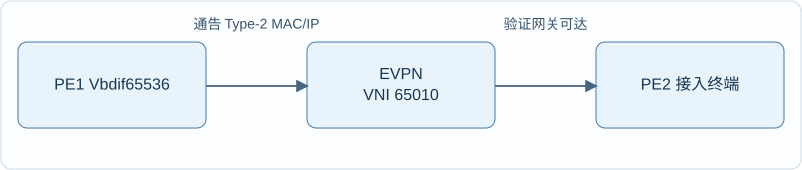

# EVPN Vbdif 网关通告 配置案例

## 拓扑



(case-conditions-06-tunnels-evpn-gateway)=
## 配置条件

沿用[高位 BD 的动态 VXLAN](../vxlan-evpn.md) 双端配置。PE1 承载 Vbdif65536，PE2 的终端与它使用同一业务前缀。

## 配置步骤

PE1 加入这段接口配置并提交。PE2 保留原有 BD/VNI 和接入口，终端设置 203.0.113.12/24 与 2001:db8:43::12/64。

```vortexros-config
bridge-domain 65536
#
interface Vbdif 65536
 mac-address 02:76:81:43:00:fe
 ip address 203.0.113.254 255.255.255.0
 ipv6 enable
 ipv6 address 2001:db8:43::fe 64
#
return
```

如果部署的是分布式 Anycast 网关，在每台提供该网关的 PE 上使用一致的网关 MAC 和地址，并在该 Vbdif 视图追加 `vxlan anycast-gateway enable`。

(case-verification-06-tunnels-evpn-gateway)=
## 验证方法

对照以下命令和预期结果核对设备状态。

```vortexros-cli
display interface Vbdif 65536
display bgp evpn all routing-table mac-route
display mac-address bridge-domain 65536
```

PE1 的网关接口应为 up，PE2 应能查询到通告的两条 Type-2 MAC/IP 路径，终端应可访问两个网关地址。从 PE1 删除网关并提交后，核对 PE2 不再看到该设备发布的 MAC/IP。
