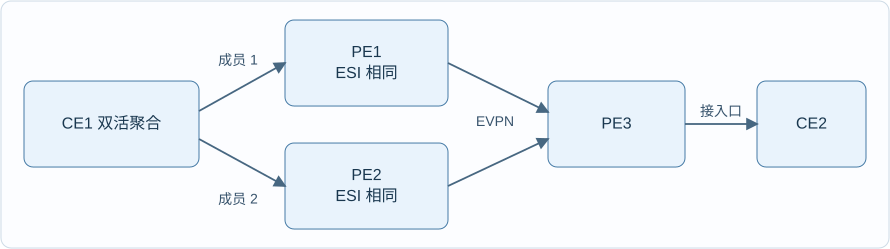

(section-operator-06-tunnels-evpn-multihoming-1)=
# EVPN All-Active 多归属

<span id="overview"></span>

All-Active 允许一个客户以太网段同时通过两台 PE 转发。

<span id="principles"></span>

(section-operator-06-tunnels-evpn-multihoming-2)=
## 工作原理

同一 Ethernet Segment 以 ESI 标识。Type-4 用于发现同段 PE 和参与 DF 选举，Type-1 辅助发现和撤销可用路径。All-Active 可以有多条单播路径，DF 负责指定方向的某些泛洪流量。验收需要检查链路故障切换。

All-Active 允许多个 PE 承载同一 Ethernet Segment。DF 和不同路径的 EVPN 通告共同控制泛洪与冗余。

<span id="examples"></span>

(section-operator-06-tunnels-evpn-multihoming-3)=
## 配置与验证

(section-operator-06-tunnels-evpn-multihoming-4)=
### 拓扑



(case-conditions-06-tunnels-evpn-multihoming)=
### 配置条件

三台 PE 通过 Ethernet0 接同一个 IPv4 底层网段 192.0.2.0/24，建立全互联 EVPN 邻居。CE1 用静态双活聚合，一端接 PE1 的 Ethernet1，另一端接 PE2 的 Ethernet1。CE2 接 PE3 的 Ethernet1。两个客户位于同一 VLAN 和网段。

(section-operator-06-tunnels-evpn-multihoming-5)=
### 配置步骤

分别录入以下配置并提交。PE1、PE2 使用相同 ESI。PE3 用普通接入口。

**PE1**

```vortexros-config
interface Ethernet 0
 ip address 192.0.2.1 255.255.255.0
#
enable switch
#
vlan 101
#
evpn-overlay enable
#
bridge-domain 101
 l2 binding vlan 101
 vxlan vni 5010
 evpn
  route-distinguisher 65000:101
  vpn-target 65000:5010 export-extcommunity
  vpn-target 65000:5010 import-extcommunity
#
interface Nve 1
 source 192.0.2.1
 vni 5010 head-end peer-list protocol bgp
#
interface Eth-Trunk 1
 mode manual
 trunkport Ethernet 1
 portswitch
 port link-type trunk
 port trunk allow-pass vlan 101
 port trunk pvid vlan 101
 esi 0000.0000.0000.0000.0001
#
bgp 65000
 router-id 192.0.2.1
 peer 192.0.2.2 as-number 65000
 peer 192.0.2.3 as-number 65000
 l2vpn-family evpn
  peer 192.0.2.2 enable
  peer 192.0.2.3 enable
#
return
```

**PE2**

```vortexros-config
interface Ethernet 0
 ip address 192.0.2.2 255.255.255.0
#
enable switch
#
vlan 101
#
evpn-overlay enable
#
bridge-domain 101
 l2 binding vlan 101
 vxlan vni 5010
 evpn
  route-distinguisher 65000:201
  vpn-target 65000:5010 export-extcommunity
  vpn-target 65000:5010 import-extcommunity
#
interface Nve 1
 source 192.0.2.2
 vni 5010 head-end peer-list protocol bgp
#
interface Eth-Trunk 1
 mode manual
 trunkport Ethernet 1
 portswitch
 port link-type trunk
 port trunk allow-pass vlan 101
 port trunk pvid vlan 101
 esi 0000.0000.0000.0000.0001
#
bgp 65000
 router-id 192.0.2.2
 peer 192.0.2.1 as-number 65000
 peer 192.0.2.3 as-number 65000
 l2vpn-family evpn
  peer 192.0.2.1 enable
  peer 192.0.2.3 enable
#
return
```

**PE3**

```vortexros-config
interface Ethernet 0
 ip address 192.0.2.3 255.255.255.0
#
enable switch
#
vlan 101
#
evpn-overlay enable
#
bridge-domain 101
 l2 binding vlan 101
 vxlan vni 5010
 evpn
  route-distinguisher 65000:301
  vpn-target 65000:5010 export-extcommunity
  vpn-target 65000:5010 import-extcommunity
#
interface Nve 1
 source 192.0.2.3
 vni 5010 head-end peer-list protocol bgp
#
interface Ethernet 1
 portswitch
 port link-type access
 port default vlan 101
#
bgp 65000
 router-id 192.0.2.3
 peer 192.0.2.1 as-number 65000
 peer 192.0.2.2 as-number 65000
 l2vpn-family evpn
  peer 192.0.2.1 enable
  peer 192.0.2.2 enable
#
return
```

(case-verification-06-tunnels-evpn-multihoming)=
### 验证方法

对照以下命令和预期结果核对设备状态。

```vortexros-cli
display bgp evpn peer
display bgp evpn ethernet-segment verbose
display bgp evpn all routing-table ad-route
display bgp evpn all routing-table es-route
display mac-address
```

PE1 和 PE2 应看到同一 Ethernet Segment，其中一台为 DF。PE3 应收到两台的 Ethernet A-D 和 Ethernet Segment 路径。CE1 与 CE2 应互通。关闭 PE1 的客户成员后重新查询，PE3 应保留 PE2 路径并继续转发；恢复成员后确认双路径恢复。

<span id="observed"></span>

(section-operator-06-tunnels-evpn-multihoming-6)=
### 同一站点两台 PE 的实测结果

四节点拓扑使用两台 PE 接入同一个站点、第三台 PE 作远端，第四台作路由反射器。两端识别到同一个 ESI。P2 的协议状态如下，LRN 中的 N 表示该节点为非指定转发者。远端为同一个站点 MAC 安装两个可用下一跳。断开一路后验证了业务切换，数据面重启后验证了学习恢复。

```text
Type: B bypass, L local, R remote, N non-DF
ESI                            Type ES-IF                 State VTEPs
00:00:11:11:22:22:11:11:11:11  LRN  evpn-es1              up    10.255.0.1
```

<span id="precautions"></span>

(section-operator-06-tunnels-evpn-multihoming-7)=
## 注意事项

两台接入 PE 使用相同 ESI，CE 双活聚合应与 PE 行为匹配。故障验证要覆盖单成员、双成员恢复和对端实际流量。

<p data-legacy-id="id1" class="manual-previous-section" data-section-moved><a href="#overview">介绍</a></p>
<p data-legacy-id="id2" class="manual-previous-section" data-section-moved><a href="#case-conditions-06-tunnels-evpn-multihoming">配置准备</a></p>
<p data-legacy-id="id3" class="manual-previous-section" data-section-moved><a href="#examples">配置案例</a></p>
<p data-legacy-id="id4" class="manual-previous-section" data-section-moved><a href="#case-verification-06-tunnels-evpn-multihoming">验证配置</a></p>
