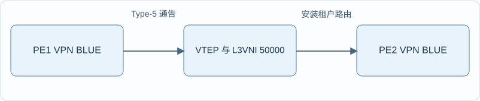

(section-operator-06-tunnels-evpn-type5-1)=
# EVPN Type-5 租户路由

<span id="overview"></span>

EVPN Type-5 在 VTEP 之间通告租户的 IPv4 和 IPv6 前缀。

<span id="principles"></span>

(section-operator-06-tunnels-evpn-type5-2)=
## 工作原理

Type-5 发布租户 IP 前缀。导入端用 Route Target 决定前缀能否进入对应三层 VPN，再解析 VTEP 下一跳。测试时应分别核对两个 VPN 的路由表和两个租户的端到端流量。

Type-5 为租户发布 IPv4、IPv6 IP 前缀，并按 L3VNI 与 RT 区分业务。

<span id="examples"></span>

(section-operator-06-tunnels-evpn-type5-3)=
## 配置与验证

(section-operator-06-tunnels-evpn-type5-4)=
### 拓扑



(case-conditions-06-tunnels-evpn-type5)=
### 配置条件

PE1 与 PE2 的 Ethernet0 以 192.0.2.0/24 相连，均使用租户 BLUE 和 L3VNI 50000。两端 RT 相同、RD 各自唯一。

同一 PE 为一个 L3VNI 通告两个地址族时，IPv4 和 IPv6 的 RD 及导入、导出 RT 使用相同值。

(section-operator-06-tunnels-evpn-type5-5)=
### 配置步骤

两端分别录入并提交。该案例使用环回前缀模拟各站点业务。

**PE1**

```vortexros-config
interface Ethernet 0
 ip address 192.0.2.1 255.255.255.0
#
evpn-overlay enable
#
ip vpn-instance BLUE
 vxlan vni 50000
 ipv4-family
  route-distinguisher 65000:50101
  vpn-target 65000:50000 both
 #
 ipv6-family
  route-distinguisher 65000:50101
  vpn-target 65000:50000 both
#
interface LoopBack 100
 ip binding vpn-instance BLUE
 ip address 198.51.100.1 255.255.255.255
 ipv6 enable
 ipv6 address 2001:db8:1::1 128
#
interface Nve 1
 source 192.0.2.1
#
bgp 65000
 router-id 192.0.2.1
 peer 192.0.2.2 as-number 65000
 l2vpn-family evpn
  peer 192.0.2.2 enable
 #
 ipv4-family vpn-instance BLUE
  import-route direct
  advertise l2vpn evpn
 #
 ipv6-family vpn-instance BLUE
  import-route direct
  advertise l2vpn evpn
#
return
```

**PE2**

```vortexros-config
interface Ethernet 0
 ip address 192.0.2.2 255.255.255.0
#
evpn-overlay enable
#
ip vpn-instance BLUE
 vxlan vni 50000
 ipv4-family
  route-distinguisher 65000:50201
  vpn-target 65000:50000 both
 #
 ipv6-family
  route-distinguisher 65000:50201
  vpn-target 65000:50000 both
#
interface LoopBack 100
 ip binding vpn-instance BLUE
 ip address 198.51.100.2 255.255.255.255
 ipv6 enable
 ipv6 address 2001:db8:2::1 128
#
interface Nve 1
 source 192.0.2.2
#
bgp 65000
 router-id 192.0.2.2
 peer 192.0.2.1 as-number 65000
 l2vpn-family evpn
  peer 192.0.2.1 enable
 #
 ipv4-family vpn-instance BLUE
  import-route direct
  advertise l2vpn evpn
 #
 ipv6-family vpn-instance BLUE
  import-route direct
  advertise l2vpn evpn
#
return
```

(case-verification-06-tunnels-evpn-type5)=
### 验证方法

对照以下命令和预期结果核对设备状态。

```vortexros-cli
display bgp evpn peer
display bgp evpn all routing-table prefix-route
display bgp evpn vpn-instance BLUE vni
display ip routing-table vpn-instance BLUE
display ipv6 routing-table vpn-instance BLUE
```

EVPN 邻居应建立，远端 Type-5 的下一跳是对端 VTEP。PE1 的 BLUE 应有 198.51.100.2/32 与 2001:db8:2::1/128，PE2 应有反向前缀。从 BLUE 测试双栈连通。撤销 PE2 相应地址族的 `advertise l2vpn evpn` 并提交后，PE1 应撤掉该地址族的远端前缀。

<span id="observed"></span>

(section-operator-06-tunnels-evpn-type5-6)=
### 两个租户的双栈转发实测结果

两台 PE 通过 EVPN 交换两个租户的 IPv4 和 IPv6 前缀。同一租户内双栈可达，两个租户间保持隔离。撤销一个租户的通告时，其前缀停止可达，另一租户和同设备上的二层业务仍可用。实测还确认了数据面重启后恢复。

双租户拓扑中，在源 VTEP 为 `10.255.0.1` 的 PE 查询 BLUE，实测只返回本租户的 L3 VNI 50000。

```text
<P1> display bgp evpn vpn-instance BLUE vni
EVPN VPN Instance VNI Information
VNI    Type  Route distinguisher  Source VTEP  Local L2 VNI
-------------------------------------------------------------------------------
50000  L3    65000:50001          10.255.0.1   -
-------------------------------------------------------------------------------
Total: 1
```

<span id="precautions"></span>

(section-operator-06-tunnels-evpn-type5-7)=
## 注意事项

同一 PE 的双栈 L3VNI 使用一致的 RD 与 RT。不同 PE 使用各自的 RD，并验证远端前缀导入正确 VPN。

<p data-legacy-id="id1" class="manual-previous-section" data-section-moved><a href="#overview">介绍</a></p>
<p data-legacy-id="id2" class="manual-previous-section" data-section-moved><a href="#case-conditions-06-tunnels-evpn-type5">配置准备</a></p>
<p data-legacy-id="id3" class="manual-previous-section" data-section-moved><a href="#examples">配置案例</a></p>
<p data-legacy-id="id4" class="manual-previous-section" data-section-moved><a href="#case-verification-06-tunnels-evpn-type5">验证配置</a></p>
