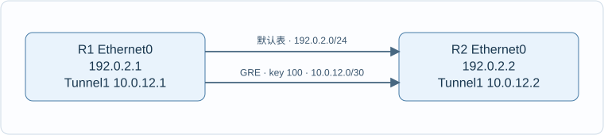

# 默认路由表中的双端 GRE

## 拓扑



## 配置条件

准备两台三层设备。各端的本机外层地址必须存在，且能在选定底层路由表中到达对端地址。规划独立的隧道内层网段。

R1、R2 用 Ethernet0 上的 192.0.2.1 和 192.0.2.2 作为外层地址，经 Tunnel1 承载 10.0.12.0/30。双方 GRE key 均为 100。

## 配置步骤

两台设备分别在系统视图录入各自的配置片段，退出功能视图后提交。

**R1**

```vortexros-config
interface Ethernet 0
 ip address 192.0.2.1 255.255.255.0
#
interface Tunnel 1
 tunnel-protocol gre
 source 192.0.2.1
 destination 192.0.2.2
 gre key 100
 mtu 1472
 ip address 10.0.12.1 255.255.255.252
#
return
```

**R2**

```vortexros-config
interface Ethernet 0
 ip address 192.0.2.2 255.255.255.0
#
interface Tunnel 1
 tunnel-protocol gre
 source 192.0.2.2
 destination 192.0.2.1
 gre key 100
 mtu 1472
 ip address 10.0.12.2 255.255.255.252
#
return
```

## 验证方法

对照{ref}`本功能页的实测结果 <recorded-result-06-tunnels-gre>`可以核对设备实际显示的字段或业务表现。不同拓扑请按本案例的地址和接口检查。

对照以下命令和预期结果核对设备状态。

```vortexros-cli
display interface Tunnel 1
display ip routing-table protocol direct
```

R1 执行 `display interface Tunnel 1` 的预期回显节选如下。

```text
Tunnel1 current state : UP
Line protocol current state : UP
Internet Address is 10.0.12.1/30
```

两端隧道为 up，10.0.12.0/30 为直连。R1 ping 10.0.12.2，R2 ping 10.0.12.1。撤掉某端底层可达路径后检查状态变化，恢复路径时复查双向流量。
