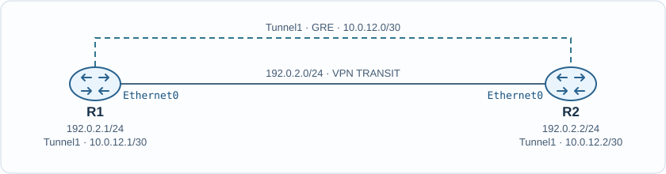

# 使用 VPN 实例作为底层

## 拓扑



## 配置条件

准备两台三层设备。各端的本机外层地址必须存在，且能在选定底层路由表中到达对端地址。规划独立的隧道内层网段。

沿用 [默认路由表中的双端 GRE](default-routing-table.md) 的两端地址。先在两台设备创建名为 TRANSIT 的 IPv4 VPN 实例，将持有外层地址的接口绑定到 TRANSIT，再为其配置地址。确认 TRANSIT 中能到达对端外层地址。保留 Tunnel1 的内层地址、MTU 和 GRE key，只改外层地址的查表范围。

## 配置步骤

**R1**

```text
interface Tunnel 1
 source 192.0.2.1 vpn-instance TRANSIT
 destination 192.0.2.2 vpn-instance TRANSIT
quit
commit
```

**R2**

```text
interface Tunnel 1
 source 192.0.2.2 vpn-instance TRANSIT
 destination 192.0.2.1 vpn-instance TRANSIT
quit
commit
```

## 验证方法

对照以下命令和预期结果核对设备状态。

```vortexros-cli
display ip routing-table vpn-instance TRANSIT
display interface Tunnel 1
```

R2 执行 `display interface Tunnel 1` 的预期回显节选如下。

```text
Tunnel1 current state : UP
Line protocol current state : UP
Internet Address is 10.0.12.2/30
```

两端的 TRANSIT 路由表都应能到达对端外层地址，Tunnel1 的 PHY 和 Protocol 均应为 up。再从 R1 和 R2 分别 ping 对端隧道地址。
