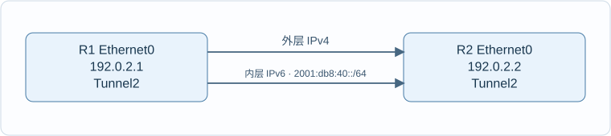

# IPv6 业务经 IPv4 底层

## 拓扑



## 配置条件

准备两个可达的三层外层端点，并按内层和外层地址族选择相同的封装模式。隧道网络与底层链路使用不同网段。

R1 与 R2 的 Ethernet0 互联。外层使用两端真实接口地址，内层通过 Tunnel2 组成独立的业务网段。以下模式分别部署，不在同一个 Tunnel2 上叠加。

## 配置步骤

两台设备分别在系统视图录入各自的配置片段，退出功能视图后提交。

**R1**

```vortexros-config
interface Ethernet 0
 ip address 192.0.2.1 255.255.255.0
#
interface Tunnel 2
 tunnel-protocol ipv6-ipv4
 source 192.0.2.1
 destination 192.0.2.2
 ipv6 enable
 ipv6 address 2001:db8:40::1 64
#
return
```

**R2**

```vortexros-config
interface Ethernet 0
 ip address 192.0.2.2 255.255.255.0
#
interface Tunnel 2
 tunnel-protocol ipv6-ipv4
 source 192.0.2.2
 destination 192.0.2.1
 ipv6 enable
 ipv6 address 2001:db8:40::2 64
#
return
```

## 验证方法

对照{ref}`本功能页的实测结果 <recorded-result-06-tunnels-ip-in-ip>`可以核对设备实际显示的字段或业务表现。不同拓扑请按本案例的地址和接口检查。

对照以下命令和预期结果核对设备状态。

```vortexros-cli
display interface Tunnel 2
display ipv6 interface brief
display ipv6 routing-table protocol direct
```

隧道接口应为 up，直连前缀 2001:db8:40::/64 指向 Tunnel2。分别从两端 ping 对端的隧道 IPv6 地址。
