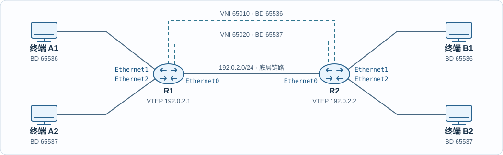

# 高位域隔离、组播订阅与 MAC/IP 迁移

## 拓扑



## 配置条件

先配置两端底层接口、BGP EVPN 邻居和 VTEP 源。两个站点的 VNI 与 RT 相同，RD 分别配置。

在双端高位 BD 案例上增加第二个业务域。两端复用同一 VTEP 源，Ethernet1 保留原高位域，Ethernet2 加入 BD 65537。如果需要观察订阅只选择一个远端，可增加第三个 VTEP，并在它上面复用相同配置、不同 RD 和本地 VTEP 地址。

## 配置步骤

```vortexros-config
evpn-overlay enable
#
bgp 65000
 router-id 192.0.2.1
 peer 192.0.2.2 as-number 65000
 l2vpn-family evpn
  peer 192.0.2.2 enable
#
bridge-domain 65537
 vxlan vni 65020
 evpn
  route-distinguisher 65000:1201
  vpn-target 65000:65020 export-extcommunity
  vpn-target 65000:65020 import-extcommunity
#
interface Ethernet 2
 bridge-domain 65537
#
interface Nve 1
 source 192.0.2.1
 vni 65020 head-end peer-list protocol bgp
#
return
```

这是 R1 增量，保留当前 VNI 65010。R2 使用相同的业务接口、BD、VNI 和 RT，RD 改成 65000:1202。R2 沿用原双端案例的 Router ID、对端地址和 NVE 源地址。两端分别录入并提交。

## 验证方法

对照{ref}`本功能页的实测结果 <recorded-result-06-tunnels-vxlan-evpn>`可以核对设备实际显示的字段或业务表现。不同拓扑请按本案例的地址和接口检查。

对照以下命令和预期结果核对设备状态。

```vortexros-cli
display bridge-domain 65536
display bridge-domain 65537
display bgp evpn all routing-table mac-route
display mac-address bridge-domain 65536
display mac-address bridge-domain 65537
```

1. 分别为两域配置测试终端，可以复用相同 IPv4/IPv6 和 MAC。每域的同域端点应互通，另一域的接入口不应收到报文。
2. 从某域两端生成 IPv4 ARP 和 IPv6 NS。首先确认远端 MAC/IP 通告已出现。发往已知端点的请求可由本地抑制处理，未知请求继续在本域内转发。
3. 迁移同一终端至同域另一台 PE，检查 Type-2 的下一跳改为新位置，旧出口撤销。另一 BD 的同名表项保持可用。
4. 测试组播时，在该域提供 IGMP 或 MLD 查询器，让接收端加入组后查看各端实际收包。存在有效查询器时只应转发至有订阅的成员及需要的组播路由器端口。取消订阅并等待相应组状态到期，再核对不再向该接入口复制报文。两个高位域可使用相同组地址。

[高位 Bridge Domain](../../../03-interfaces-l2/bridge-domain.md) · [BGP](../../../05-dynamic-routing/bgp.md)
