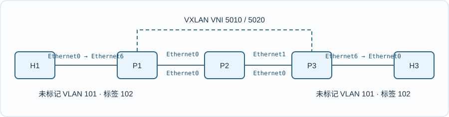

# 两个二层 VNI 的接入与独立撤销

## 拓扑



| 对象 | P1 站点 | P3 站点 |
| --- | --- | --- |
| 到 P2 | Ethernet0，`10.201.12.1/24`，对端 `10.201.12.2` | Ethernet0，`10.201.23.3/24`，对端 `10.201.23.2` |
| LoopBack0 / VTEP | `10.255.0.1/32` | `10.255.0.3/32` |
| VLAN 101 / BD 101 / VNI 5010 | H1 `192.0.2.1/24`，RD `65000:101` | H3 `192.0.2.3/24`，RD `65000:301` |
| VLAN 102 / BD 102 / VNI 5020 | H1 `198.18.2.1/24`，RD `65000:102` | H3 `198.18.2.3/24`，RD `65000:302` |

## 配置条件

在 P2 配置两个连接网段，并将两端的 VTEP /32 分别指向 P1、P3。P1 与 P3 各经 P2 到达对端 VTEP。从本地 LoopBack0 分别探测对端 VTEP，确认底层可达后再建立 EVPN。

## 配置步骤

**P2**

```vortexros-config
interface Ethernet 0
 ip address 10.201.12.2 255.255.255.0
#
interface Ethernet 1
 ip address 10.201.23.2 255.255.255.0
#
ip route-static 10.255.0.1 255.255.255.255 10.201.12.1
ip route-static 10.255.0.3 255.255.255.255 10.201.23.3
#
return
```

**P1 与 P3**

两端用 AS 65000 建立 EVPN，VNI 和 RT 对齐，RD 使用上表的本地值。P1 配置片段如下。P3 将地址和 RD 换为上表的 P3 值，对端改为 `10.255.0.1`。

```vortexros-config
enable switch
#
interface Ethernet 0
 ip address 10.201.12.1 255.255.255.0
#
interface LoopBack0
 ip address 10.255.0.1 255.255.255.255
#
ip route-static 10.255.0.3 255.255.255.255 10.201.12.2
#
evpn-overlay enable
#
vlan batch 101 102
#
bridge-domain 101
 l2 binding vlan 101
 vxlan vni 5010
 evpn
  route-distinguisher 65000:101
  vpn-target 65000:5010 import-extcommunity
  vpn-target 65000:5010 export-extcommunity
#
bridge-domain 102
 l2 binding vlan 102
 vxlan vni 5020
 evpn
  route-distinguisher 65000:102
  vpn-target 65000:5020 import-extcommunity
  vpn-target 65000:5020 export-extcommunity
#
interface Ethernet 6
 portswitch
 port link-type trunk
 port trunk allow-pass vlan 101 102
 port trunk pvid vlan 101
#
interface Nve1
 source 10.255.0.1
 vni 5010 head-end peer-list protocol bgp
 vni 5020 head-end peer-list protocol bgp
#
bgp 65000
 router-id 10.255.0.1
 peer 10.255.0.3 as-number 65000
 peer 10.255.0.3 connect-interface LoopBack0
 l2vpn-family evpn
  peer 10.255.0.3 enable
#
return
```

在 P1 和 P3 提交。终端接入 Ethernet6，VLAN 101 使用未标记帧，VLAN 102 使用标签 102。如果会话已建立但二层不通，先核对 BD 的 `l2 binding vlan`、入方向 PVID 和对端的标签规则。

## 验证与撤销

```vortexros-cli
display bgp evpn peer
display vxlan tunnel
display mac-address bridge-domain 101
display mac-address bridge-domain 102
```

两端终端各在自己的业务网段发包。在 P1 核对本地接入口与远端 VTEP。以下为同一拓扑上的隧道表实测节选。

```text
Tunnel ID   Source       Destination   State   Type
20          10.255.0.1   10.255.0.3    up      L2 dynamic
21          10.255.0.1   10.255.0.3    up      L2 dynamic
```

在 P1 的 `Nve1` 撤销 `vni 5010 head-end peer-list protocol bgp` 并提交，重复两个网段的探测。实测 VNI 5010 的远端路由撤销且对应业务不通，VNI 5020 的业务继续转发。重新配置 VNI 5010 后两个网段均恢复。
