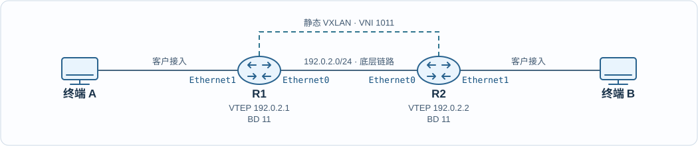

# 为已有桥域添加一个静态对端

## 拓扑



## 配置条件

两端 VTEP 的底层地址彼此可达，启用相应的桥域和数据面。选择相同 VNI，并规划每端本地接入口。

示例源地址为 192.0.2.1，远端为 192.0.2.2。对端使用自己的源地址，并将 192.0.2.1 配为远端。

## 配置步骤

```text
interface Nve 1
 source 192.0.2.1
 vni 1011 head-end peer-list 192.0.2.2
```

使用 [Bridge Domain](../../../03-interfaces-l2/bridge-domain.md) 绑定本地业务。验证时可执行：

```vortexros-cli
display vxlan tunnel
display vxlan statistics source 192.0.2.1 peer 192.0.2.2 vni 1011
display bridge-domain 11
display mac-address
```

删除远端或整个NVE配置：

```text
interface Nve 1
 undo vni 1011 head-end peer-list 192.0.2.2
quit
undo interface Nve 1
commit
```

## 验证方法

对照以下命令和预期结果核对设备状态。

```vortexros-cli
display vxlan tunnel
display bridge-domain 11
```

确认 VNI 1011 的本端源与远端 192.0.2.2，BD 11 存在关联。两端分别发包后核对隧道计数增加。
