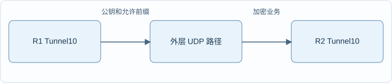

# 使用固定对端和业务前缀

## 拓扑



## 配置条件

交换公钥，规划内层地址、外层路由及监听 UDP 端口。准备每端独立生成的私钥。

Profile只保存peer集合；Tunnel保存private key、underlay、监听端口和profile引用。

## 配置步骤

```text
wireguard profile WG-PROFILE
 peer SITE-B
  publickey BASE64-PUBLIC-KEY
  allowd-ip 10.20.0.0 16
  destination 198.51.100.2 port 51820
  keepalive 25
#
interface Tunnel 10
 tunnel-protocol wireguard
 privatekey auto
 source vpn-instance default
 wireguard-profile WG-PROFILE
 mtu 1500
 ip address 10.255.0.1 255.255.255.252
```

`source vpn-instance NAME [IP]`选择underlay VPN；最后的源IP可以省略，省略时VPP按peer endpoint在该VPN中的路由自动选源。客户端省略`source-port`，每次创建接口时使用随机临时源端口。只有作为监听端的服务端才配置固定`source-port`。

Allowed IP限制该peer允许收发的地址范围。Tunnel自身配置的直连前缀如果被某个Allowed IP覆盖，数据面会自动把这个直连前缀映射到最长前缀匹配的peer，因此纯L3 Tunnel上的`/24`等直连网段不需要ARP，也不需要为对端再补`/32`静态路由。Allowed IP不会为Tunnel之外的任意业务网段自动创建系统路由；这些网段仍需静态或动态路由。

Tunnel显式source与所有已配置的peer destination必须使用同一外层地址族。IPv6 overlay可以与IPv4或IPv6 underlay组合，需为peer显式配置IPv6 `allowd-ip`；未配置任何`allowd-ip`时默认仅为`0.0.0.0/0`。不同peer可以配置嵌套的Allowed IP，数据面按最长前缀选择peer；完全相同的前缀不能由两个peer同时拥有。

服务端peer可以不配置`destination`，首个通过认证的报文会学习并更新该peer的漫游endpoint；这种模式必须在Tunnel上配置固定监听端口：

```text
wireguard profile WG-SERVER
 peer ROAMING-CLIENT
  publickey BASE64-PUBLIC-KEY
  allowd-ip 10.40.0.0 24
#
interface Tunnel 11
 tunnel-protocol wireguard
 privatekey auto
 source vpn-instance default
 source-port 51820
 wireguard-profile WG-SERVER
 ip address 10.40.0.1 255.255.255.0
```

- 新增或删除peer只影响该peer；
- 修改密钥、目的地址或监听参数时，相关Tunnel可能短暂重新建立；
- profile仍被Tunnel引用时不能删除；
- 修改underlay source或VPN后，应重新检查到peer公网地址的路由。

```text
interface Tunnel 10
 undo wireguard-profile
 undo source
quit
undo wireguard profile WG-PROFILE
commit
```

```vortexros-cli
display wireguard interface
display interface Tunnel 10
display ip routing-table
ping -vpn-instance BLUE 10.255.0.2
```

除接口状态外，还应从对端确认握手、收发计数和业务路由。只有Tunnel地址可达而业务前缀没有路由时，WireGuard不会自动补充路由。

## 验证方法

对照{ref}`本功能页的实测结果 <recorded-result-06-tunnels-wireguard>`可以核对设备实际显示的字段或业务表现。不同拓扑请按本案例的地址和接口检查。

对照以下命令和预期结果核对设备状态。

```vortexros-cli
display wireguard interface
display interface Tunnel 10
```

用实际业务触发握手，检查对端最近握手时间与流量计数并验证回程。
