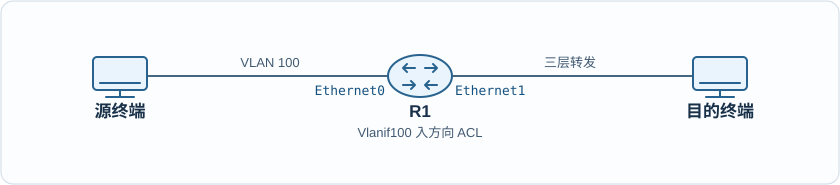

(section-operator-07-policy-acl-1)=
# ACL 访问控制

<span id="overview"></span>

ACL 按地址、协议及端口匹配报文。接口引用 ACL 后可限制访问，也可在流量策略中复用相同的匹配规则。

<span id="principles"></span>

(section-operator-07-policy-acl-2)=
## 工作原理

ACL 规则按顺序匹配。绑定至接口方向或给其它策略引用后才影响流量。核对规则内容与绑定位置，再用命中和不命中报文检查实际行为。

规则按序匹配，接口绑定时用首条命中决定允许或拒绝。ACL 还可供流量分类引用。

<span id="examples"></span>

(section-operator-07-policy-acl-3)=
## 配置与验证

(section-operator-07-policy-acl-4)=
### 拓扑



(case-conditions-07-policy-acl)=
### 配置条件

明确允许与拒绝的网段和端口，并预留独立管理路径。接口方向按业务流向选择。

(section-operator-07-policy-acl-5)=
### 配置步骤

```text
acl name WEB-IN advance
 rule 10 permit tcp source 10.0.0.0 0.0.0.255 destination-port eq 443
 rule 20 deny ip
```

ACL可被接口traffic-filter、MQC classifier和SSH源地址保护等功能引用。删除ACL前必须先解除所有引用。

直接绑定到接口：

```text
interface Vlanif 100
 traffic-filter inbound acl WEB-IN
```

提交后，进入Vlanif100的报文按规则序号从小到大匹配。首条匹配规则决定permit或deny；进入ACL检查
但未匹配任何规则的IP报文默认丢弃。零规则的空ACL绑定到接口后同样默认丢弃IPv4和IPv6流量；
ACL仅创建、未绑定接口时不会过滤接口流量。

例如只拒绝Telnet、其余IPv4流量放行时，必须显式配置末尾兜底规则：

```text
acl name BLOCK-TELNET advance
 rule 10 deny tcp destination-port eq 23
 rule 100 permit ip
```

`permit ip`只兜底IPv4。设备放行规则完全未涉及的另一地址族；同时配置IPv4和IPv6规则时，
两个地址族各自保持未匹配默认丢弃。

```vortexros-cli
display acl name WEB-IN
display interface Vlanif 100
```

```text
interface Vlanif 100
 undo traffic-filter inbound
quit
undo acl name WEB-IN
commit
```

(case-verification-07-policy-acl)=
### 验证方法

对照以下命令和预期结果核对设备状态。

```vortexros-cli
display acl name WEB-IN
display interface Vlanif 100
```

检查规则顺序与绑定方向。分别发送匹配允许、显式拒绝和未匹配的报文，确认结果。

<span id="observed"></span>

(section-operator-07-policy-acl-6)=
### 运行查询实测节选

r4 的 ACL 查询节选。核对规则编号、匹配方向所用的地址和动作，再从业务两侧验证匹配效果。

```text
<VortexROS> display acl all
acl name P123-PBR-SOURCE advance
 rule 10 permit ip source 198.18.0.0 0.0.255.255

acl name P123-PERMIT advance
 rule 10 permit ip

acl name VIF-IN-ACL advance
 rule 10 permit ip
```

<span id="precautions"></span>

(section-operator-07-policy-acl-7)=
## 注意事项

保留独立管理入口，检查末尾策略和未匹配流量。撤销前核对 ACL 是否仍被接口或分类器引用。

<p data-legacy-id="id1" class="manual-previous-section" data-section-moved><a href="#overview">介绍</a></p>
<p data-legacy-id="id2" class="manual-previous-section" data-section-moved><a href="#case-conditions-07-policy-acl">配置准备</a></p>
<p data-legacy-id="id3" class="manual-previous-section" data-section-moved><a href="#examples">配置案例</a></p>
<p data-legacy-id="id4" class="manual-previous-section" data-section-moved><a href="#case-verification-07-policy-acl">验证配置</a></p>
