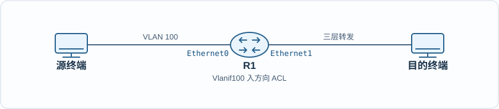

# ACL 访问控制 配置案例

## 拓扑



(case-conditions-07-policy-acl)=
## 配置条件

明确允许与拒绝的网段和端口，并预留独立管理路径。接口方向按业务流向选择。

## 配置步骤

```text
acl name WEB-IN advance
 rule 10 permit tcp source 10.0.0.0 0.0.0.255 destination-port eq 443
 rule 20 deny ip
```

ACL可被接口traffic-filter、MQC classifier和SSH源地址保护等功能引用。删除ACL前必须先解除所有引用。

直接绑定到接口：

```text
interface Vlanif 100
 traffic-filter inbound acl WEB-IN
```

提交后，进入Vlanif100的报文按规则序号从小到大匹配。首条匹配规则决定permit或deny；进入ACL检查
但未匹配任何规则的IP报文默认丢弃。零规则的空ACL绑定到接口后同样默认丢弃IPv4和IPv6流量；
ACL仅创建、未绑定接口时不会过滤接口流量。

例如只拒绝Telnet、其余IPv4流量放行时，必须显式配置末尾兜底规则：

```text
acl name BLOCK-TELNET advance
 rule 10 deny tcp destination-port eq 23
 rule 100 permit ip
```

`permit ip`只兜底IPv4。设备放行规则完全未涉及的另一地址族；同时配置IPv4和IPv6规则时，
两个地址族各自保持未匹配默认丢弃。

```vortexros-cli
display acl name WEB-IN
display interface Vlanif 100
```

```text
interface Vlanif 100
 undo traffic-filter inbound
quit
undo acl name WEB-IN
commit
```

(case-verification-07-policy-acl)=
## 验证方法

对照以下命令和预期结果核对设备状态。

```vortexros-cli
display acl name WEB-IN
display interface Vlanif 100
```

检查规则顺序与绑定方向。分别发送匹配允许、显式拒绝和未匹配的报文，确认结果。
