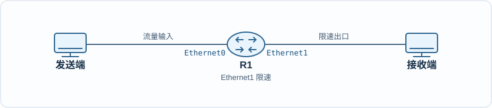

(section-operator-07-policy-interface-qos-1)=
# 接口 QoS 限速

<span id="overview"></span>

接口 QoS 对指定方向的业务限速，适用于按链路容量限制流量。

<span id="principles"></span>

(section-operator-07-policy-interface-qos-2)=
## 工作原理

限速使用速率及突发参数控制一段时间内允许通过的流量。只看瞬时速率容易误判。按实际方向发持续流，读回作用对象并对照接收端速率。物理口、VLAN、子接口和网关的挂载点各自独立。

可按接口方向做速率限制和颜色动作。配置后用持续流量及接口计数核对。

<span id="examples"></span>

(section-operator-07-policy-interface-qos-3)=
## 配置与验证

(section-operator-07-policy-interface-qos-4)=
### 拓扑



(case-conditions-07-policy-interface-qos)=
### 配置条件

先确认链路实际速率和方向，避免与同方向的 MQC 限速重复。

(section-operator-07-policy-interface-qos-5)=
### 配置步骤

若接口已经使用MQC police又配置接口QoS限速，CLI会给出INFO提示：高负载时两层限速可能产生额外丢包抖动，建议统一使用MQC限速。提示不会自动删除或合并用户配置。

```text
interface Ethernet 1
 qos lr outbound cir 1000000 pir 1000000 cbs 187500000 pbs 312500000 green pass yellow pass red discard
```

提交后，对接口出方向使用两速率三色限速；速率和突发参数以命令提示中的单位为准。查看接口配置与计数，确认实际流量是否达到预期：

```vortexros-cli
display this
display interface Ethernet 1
```

```text
interface Ethernet 1
 undo qos lr outbound
commit
```

(case-verification-07-policy-interface-qos)=
### 验证方法

对照以下命令和预期结果核对设备状态。

```vortexros-cli
display current-configuration | include qos lr
display interface Ethernet 1
```

从对端发送低于和高于限速的流量，核对接口方向、测得吞吐和丢包计数。

<span id="observed"></span>

(section-operator-07-policy-interface-qos-6)=
### 二层成员口限速的实测结果

VLAN 200 的二层成员口参与转发。在 VLAN 上配置入方向限速、撤销并重新应用后，验证了策略每次都按相应状态生效。若同时设置分类策略，应分别对比匹配流和未匹配流的流量结果。

(r4-result-operator-07-policy-interface-qos)=
### r4 实包速率

在 VLAN 200 配置 10 Mbps 入向限速，测试按线路速率计算。复验实测如下。撤销并重挂时继续核对相应接口的运行状态及实际转发。

```text
VLAN200 pure L2 shared qos-lr inbound 10M: 10820910 bps
```

<span id="precautions"></span>

(section-operator-07-policy-interface-qos-7)=
## 注意事项

参数应符合实际链路能力。避免在同一方向重复部署接口限速与 MQC 限速造成额外丢包。

<p data-legacy-id="id1" class="manual-previous-section" data-section-moved><a href="#overview">介绍</a></p>
<p data-legacy-id="id2" class="manual-previous-section" data-section-moved><a href="#case-conditions-07-policy-interface-qos">配置准备</a></p>
<p data-legacy-id="id3" class="manual-previous-section" data-section-moved><a href="#examples">配置案例</a></p>
<p data-legacy-id="id4" class="manual-previous-section" data-section-moved><a href="#case-verification-07-policy-interface-qos">验证配置</a></p>
