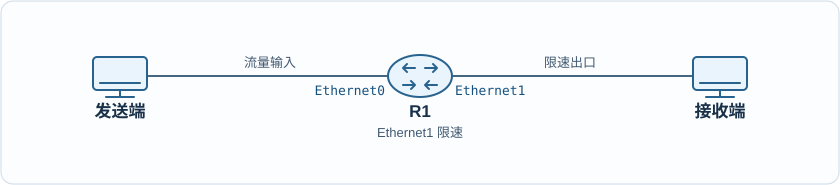

# 接口 QoS 限速 配置案例

## 拓扑



(case-conditions-07-policy-interface-qos)=
## 配置条件

先确认链路实际速率和方向，避免与同方向的 MQC 限速重复。

## 配置步骤

若接口已经使用MQC police又配置接口QoS限速，CLI会给出INFO提示：高负载时两层限速可能产生额外丢包抖动，建议统一使用MQC限速。提示不会自动删除或合并用户配置。

```text
interface Ethernet 1
 qos lr outbound cir 1000000 pir 1000000 cbs 187500000 pbs 312500000 green pass yellow pass red discard
```

提交后，对接口出方向使用两速率三色限速；速率和突发参数以命令提示中的单位为准。查看接口配置与计数，确认实际流量是否达到预期：

```vortexros-cli
display this
display interface Ethernet 1
```

```text
interface Ethernet 1
 undo qos lr outbound
commit
```

(case-verification-07-policy-interface-qos)=
## 验证方法

对照以下命令和预期结果核对设备状态。

```vortexros-cli
display current-configuration | include qos lr
display interface Ethernet 1
```

从对端发送低于和高于限速的流量，核对接口方向、测得吞吐和丢包计数。
