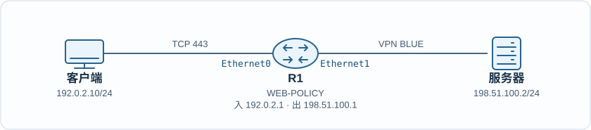

# 按 TCP 端口选择 VPN 的出口

## 拓扑



## 配置条件

先建立案例使用的 ACL WEB-IN 和 VPN BLUE，检查目标 VPN 有正确路由。

客户端 192.0.2.10 经 Ethernet0 入站。服务器 198.51.100.2 经 BLUE 的 Ethernet1 出站。先在隔离网络提供 BLUE 到客户端的回程，或使用单向接收验证。这里仅允许命中该分类的报文改用 BLUE 查路。

## 配置步骤

```vortexros-config
ip vpn-instance BLUE
 ipv4-family
#
acl name WEB-IN advance
 rule 10 permit tcp destination-port eq 443
#
traffic classifier WEB-CLASS operator and
 if-match acl WEB-IN
#
traffic behavior WEB-BEHAVIOR
 redirect vpn-instance BLUE
#
traffic policy WEB-POLICY
 classifier WEB-CLASS behavior WEB-BEHAVIOR precedence 10
#
interface Ethernet 0
 ip address 192.0.2.1 255.255.255.0
 traffic-policy WEB-POLICY inbound
#
interface Ethernet 1
 ip binding vpn-instance BLUE
 ip address 198.51.100.1 255.255.255.0
#
return
```

## 验证方法

对照以下命令和预期结果核对设备状态。

```vortexros-cli
display acl name WEB-IN
display traffic policy user-defined WEB-POLICY
display ip routing-table vpn-instance BLUE
```

从客户端发往同一服务器的 TCP 443 和另一个端口。服务器网口应收到 443 流量，其他端口继续按原路由表查找，原表无路由时不会经 BLUE 到达。修改分类器时，保留原策略绑定，提交后以新流验证结果。
