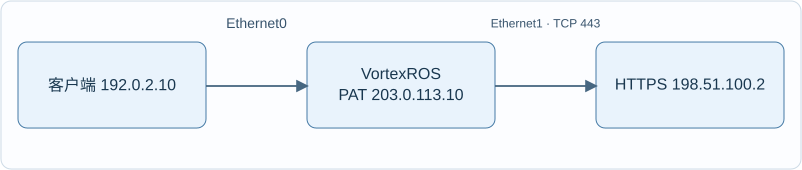

# 用地址池做出方向 PAT

## 拓扑



## 配置条件

规划内外网接口、地址池和规则顺序。确认地址池的回程能到达设备。

客户端 192.0.2.10/24 接 Ethernet0，默认网关 192.0.2.1。外部 HTTPS 服务 198.51.100.2/24 接 Ethernet1，上游需把 203.0.113.10/32 指向 198.51.100.1。录入后提交。

## 配置步骤

```vortexros-config
interface Ethernet 0
 ip address 192.0.2.1 255.255.255.0
#
interface Ethernet 1
 ip address 198.51.100.1 255.255.255.0
#
nat-policy address-set name LAN
 address 192.0.2.0/24
#
nat-policy port-set name WEB
 port 443
#
nat-policy address-pool name PUBLIC
 address 203.0.113.10
 pat-port-range 20000-65535
#
nat-policy name INTERNET
 statistic enable
 session-limit 100000
 rule 100
  priority 10
  source address-set name LAN
  destination port-set name WEB
  protocol tcp
  action snat pat address-pool PUBLIC
#
interface Ethernet 1
 nat-policy INTERNET outbound
#
return
```

## 验证方法

对照以下命令和预期结果核对设备状态。

```vortexros-cli
display nat-policy address-pool PUBLIC
display nat-policy interfaces
display nat-policy statistics name INTERNET
display nat-policy sessions protocol tcp destination-port 443 name INTERNET
```

客户端连接服务的 443 端口后，规则 100 应有命中，原始来源为 192.0.2.10，转换后来源为 203.0.113.10 和池中的端口。对端应看到转换后的来源。再建立不匹配的连接，确认其不使用此 PAT。端口池、会话限额改动后可用 `display nat-policy runtime`、`display nat-policy workers` 核对。
