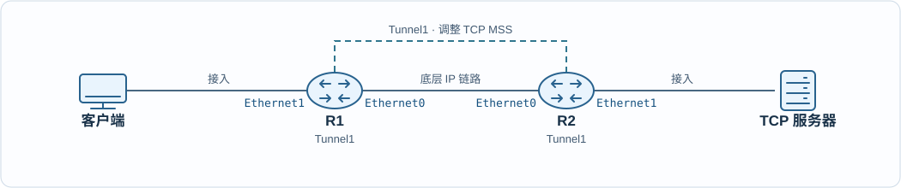

# 选择自动或固定 MSS

## 拓扑



## 配置条件

仅在三层接口或受支持的隧道上配置。核对路径 MTU，以及 TCP 流量的实际入口和出口。

TCP MSS Clamp只处理包含MSS选项的TCP SYN报文。报文中的MSS大于出接口MTU允许的上限时才会被改小；原值已经足够小或报文不是SYN时不会修改。

## 配置步骤

自动模式随接口MTU变化重新计算上限：

```text
interface Tunnel 1
 tcp mss clamp
```

也可以指定固定MSS：

```text
interface Tunnel 1
 tcp mss 1360
```

接口MTU变化后，自动模式无需重新配置。使用 `display this` 和接口统计检查配置及报文变化。删除：

```text
interface Tunnel 1
 undo tcp mss
commit
```

## 验证方法

对照以下命令和预期结果核对设备状态。

```vortexros-cli
display interface Tunnel 1
display current-configuration
```

核对隧道 MTU 和 MSS 配置。在新连接的 SYN 上检查报文段大小，确认无需调整的小值保留。
