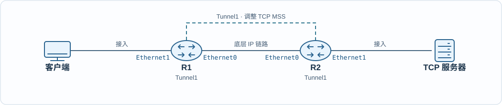

# 两端 GRE 上的双向 MSS 调整

## 拓扑



## 配置条件

仅在三层接口或受支持的隧道上配置。核对路径 MTU，以及 TCP 流量的实际入口和出口。

沿用 [GRE 双端案例](../../../06-tunnels/gre.md)。让客户端和服务器分别位于 R1 与 R2 后方，经 Tunnel1 互通。若要验证 IPv6，先在两端隧道配置 IPv6 地址和到对端网段的回程。以下是在已有隧道上的增量，两端分别录入并提交。

## 配置步骤

```text
interface Tunnel 1
 mtu 1472
 tcp mss clamp
quit
commit
```

## 验证方法

对照{ref}`本功能页的实测结果 <recorded-result-07-policy-tcp-mss>`可以核对设备实际显示的字段或业务表现。不同拓扑请按本案例的地址和接口检查。

对照以下命令和预期结果核对设备状态。

```vortexros-cli
display interface Tunnel 1
display current-configuration | include tcp mss
```

两端应显示 Tunnel1 为 up、MTU 1472 且配置使用自动调整。让客户端新建 TCP 连接，从隧道两侧检查握手。对原本通告较大 MSS 的普通 IPv4 TCP SYN，预期调整到不大于 1432 字节。对 IPv6 TCP SYN，预期不大于 1412 字节。已经小于上限的 MSS 保持原值。撤销后用新连接复验。
