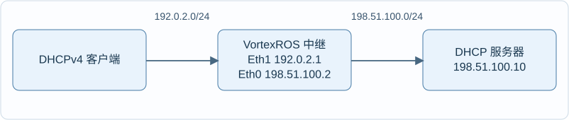

# 三节点中继和服务端回程

## 拓扑



## 配置条件

在客户端网段准备三层接口与地址。确认服务器有该网段的地址池，并能路由回中继地址。

终端通过中继的 Ethernet1 接入 192.0.2.0/24。中继 Ethernet0 与服务器 Ethernet0 直连，分别是 198.51.100.2 和 .10。服务端使用中继网段的 OFFICE 地址池，并增加到客户端网段的回程。

## 配置步骤

**服务器**

```vortexros-config
enable dhcp server
#
ip pool OFFICE
 network 192.0.2.0 mask 255.255.255.0
 gateway-list 192.0.2.1
 section 0 192.0.2.100 192.0.2.200
 lease day 1
#
interface Ethernet 0
 ip address 192.0.2.254 255.255.255.0
 ip address 198.51.100.10 255.255.255.0 sub
 dhcp select global
#
ip route-static 192.0.2.0 255.255.255.0 198.51.100.2
#
return
```

服务器主地址用于匹配 OFFICE 地址池，次地址用于与中继通信。

**中继**

```vortexros-config
interface Ethernet 0
 ip address 198.51.100.2 255.255.255.0
#
interface Ethernet 1
 ip address 192.0.2.1 255.255.255.0
 dhcp select relay
 dhcp relay server-ip 198.51.100.10
#
return
```

**客户端**

```vortexros-config
interface Ethernet 0
 ip address dhcp-alloc
#
return
```

各端提交后，在中继侧执行 `display dhcp relay`，服务端执行 `display ip pool name OFFICE used`，客户端执行 `display dhcp client`。结果应为中继正在运行，客户端拿到 192.0.2.100–200 中的地址及网关 192.0.2.1。让终端 ping 网关确认租约可用。

## 验证方法

对照{ref}`本功能页的实测结果 <recorded-result-08-network-services-dhcpv4-relay>`可以核对设备实际显示的字段或业务表现。不同拓扑请按本案例的地址和接口检查。

对照以下命令和预期结果核对设备状态。

```vortexros-cli
display dhcp relay
display ip pool name OFFICE used
display dhcp client
```

分别在中继、服务器和客户端查询中继状态、服务端有效租约和客户端当前地址。客户端应获得正确地址并可访问网关。
