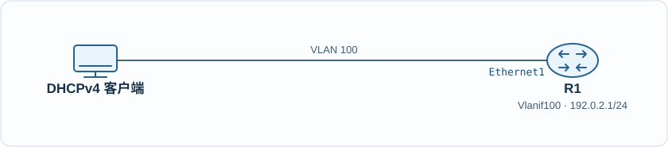

# 使用全局或接口地址池

## 拓扑



## 配置条件

准备三层接口及可用地址范围。一个地址池只绑定同一 VPN 内的一个服务接口。交换端口所在的网段应使用对应 Vlanif 提供 DHCP。

先在系统视图启用DHCP服务：

## 配置步骤

```text
enable dhcp
commit
```

使用全局地址池时，创建地址池并在三层接口启用：

```text
ip pool LAN4
 network 192.0.2.0 mask 255.255.255.0
 gateway-list 192.0.2.1
 section 0 192.0.2.100 192.0.2.200
 dns-list 1.1.1.1 8.8.8.8
 lease day 1
#
interface Vlanif 100
 ip address 192.0.2.1 255.255.255.0
 dhcp select global
```

池中的`dns-list`只作为DHCP Option通告给外部客户端，不改变VortexROS主机的`/etc/resolv.conf`。
全局地址池使用`section <编号> <起始地址> [结束地址]`限制可动态分配的地址段；可配置多个互不重叠的
section，编号范围为0至255。未配置section时使用network中的全部可用主机地址。网关、排除地址、
接口本机地址和静态绑定仍会从section中扣除。`gateway-list`与`dns-list`保持录入顺序，第一项是
客户端收到的首选地址，保存和重载不会按数值重新排序。
全局池应用到接口时，该接口在此子网内的全部本地IPv4地址都会自动从动态分配范围排除。
同一VPN实例内，一个IPv4或IPv6地址池只能绑定一个接口；当前版本不提供跨接口共享子网模型，
重复绑定会在进入待提交配置时给出明确错误。

也可以直接使用接口主地址所在网段生成接口地址池。未配置`gateway-list`时，接口主IPv4地址自动作为客户端网关：

```text
interface Vlanif 20
 ip address 192.168.10.254 255.255.255.0
 dhcp select interface
 dhcp server ip-range 192.168.10.100 192.168.10.200
 dhcp server dns-list 1.1.1.1 8.8.8.8
 dhcp server lease day 1
#
commit
```

如需通告同网段内的其他网关，可用`dhcp server gateway-list X.X.X.X [X.X.X.X]`显式替换默认值。`undo dhcp server gateway-list`恢复“接口主地址作为网关”的默认行为。确实不希望发送Router Option时，使用`dhcp server gateway-list disable`。接口本机使用的所有IPv4地址始终从动态地址池排除，与通告哪个网关无关。

接口地址池使用`dhcp server ip-range <起始地址> <结束地址>`限制可分配范围；起止地址必须属于接口
主IPv4网段且均为可用主机地址。该范围存在时优先使用它，`undo dhcp server ip-range`恢复从接口
主网段的全部可用主机地址分配。接口地址池只保存一个显式范围；需要多个不连续地址段时使用全局
地址池的多个`section`。

验证：

```vortexros-cli
display dhcp service verbose
display ip pool
display current-configuration
```

关闭接口上的服务器角色：

```text
interface Vlanif 100
 undo dhcp select
commit
```

确认已撤销需要停止的服务后，可在系统视图关闭 DHCP 服务器全局开关。

```vortexros-cli
undo enable dhcp server
commit
```

`display ip pool`同时列出全局IPv4地址池和接口地址池。需要查看Kea已经实际分配的地址时，使用与设备命令树一致的`used`参数：

## 验证方法

对照{ref}`本功能页的实测结果 <recorded-result-08-network-services-dhcpv4-server>`可以核对设备实际显示的字段或业务表现。不同拓扑请按本案例的地址和接口检查。

对照以下命令和预期结果核对设备状态。

```vortexros-cli
display ip pool used
display ip pool name OFFICE used
display ip pool interface Vlanif20 used
```

`used`只显示仍有效的已分配地址；`all`显示Kea仍保留的全部租约状态，包括已过期或被拒绝的记录。输出包含地址池或接口、客户端IP、MAC、Client-ID、剩余租期、状态、主机名和VPN实例。若租约查询报错，检查 DHCP 服务和接口状态。
