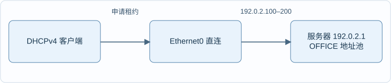

# 使用一台 VortexROS 作为租约客户端

## 拓扑



## 配置条件

准备三层接口及可用地址范围。一个地址池只绑定同一 VPN 内的一个服务接口。交换端口所在的网段应使用对应 Vlanif 提供 DHCP。

DHCP 服务器与客户端以 Ethernet0 直连。服务器静态地址 192.0.2.1/24，客户端从 OFFICE 获取 .100–.200 中的一个地址。两端分别录入并提交。

## 配置步骤

**本端设备**

```vortexros-config
enable dhcp server
#
ip pool OFFICE
 network 192.0.2.0 mask 255.255.255.0
 gateway-list 192.0.2.1
 section 0 192.0.2.100 192.0.2.200
 lease day 1
#
interface Ethernet 0
 ip address 192.0.2.1 255.255.255.0
 dhcp select global
#
return
```

**对端设备**

```vortexros-config
interface Ethernet 0
 ip address dhcp-alloc
#
return
```

## 验证方法

对照{ref}`本功能页的实测结果 <recorded-result-08-network-services-dhcpv4-server>`可以核对设备实际显示的字段或业务表现。不同拓扑请按本案例的地址和接口检查。

对照以下命令和预期结果核对设备状态。

```vortexros-cli
display ip pool name OFFICE used
display dhcp client
display ip interface brief
```

服务器执行第一条，应看到客户端 MAC 的有效租约。客户端执行后两条，应看到同一个 IPv4 地址及 Ethernet0 的 up 状态，并能 ping 192.0.2.1。
